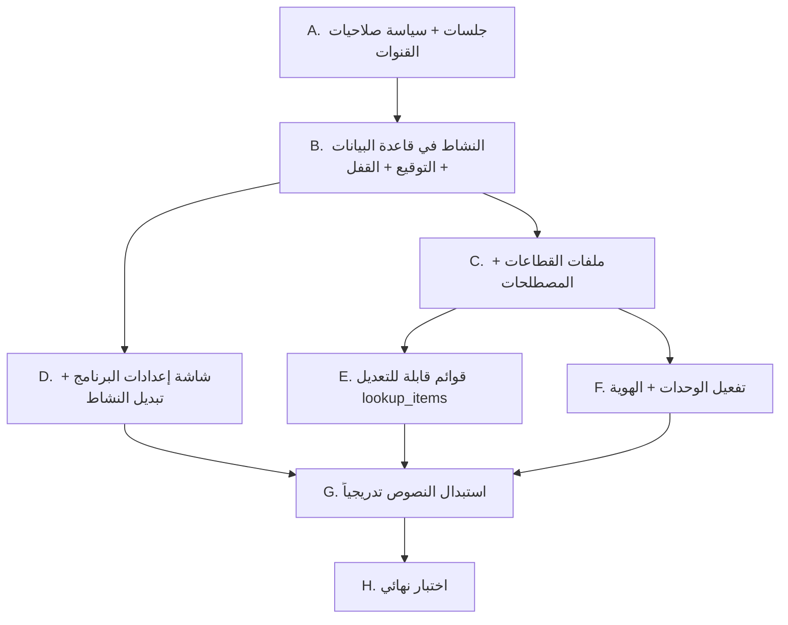

# خطة تنفيذ المرحلة 1 (تفصيلية)

مبنية على قراءة الكود الفعلي. هذه الخطة تفصّل [01-phase-abstraction.md](01-phase-abstraction.md): ماذا نعدّل وبأي ترتيب وكيف نتحقق.

## 0. اكتشافات من الكود تغيّر التنفيذ

| # | الاكتشاف | الأثر على الخطة |
|---|----------|------------------|
| 1 | **لا توجد أي مصادقة في الـ IPC ولا في RPC الشبكة.** كل القنوات في [index.ts](../src/main/index.ts) (`users:save`، `settings:save`، `backup:restore`...) تُنفَّذ لأي مستدعٍ، ومنها أي جهاز على الشبكة المحلية عبر `POST /api/rpc` في [lanServer.ts](../src/main/lanServer.ts). كما أن `GET /api/backup/download` بلا أي تحقق. | شرط «التحقق من السوبر أدمن في الـ main» **غير قابل للتحقيق دون نظام جلسات**. لذلك نضيف خطوة تمهيدية (الخطوة A) قبل أي شيء. |
| 2 | `/super-admin` تخدم أيضاً المالك والمستأجر (`canManageUsers`) كشاشة «إدارة الموظفين». | لا نحذف المسار. تُدمج الشاشة في تبويب للسوبر أدمن، ويبقى المسار لباقي الأدوار. |
| 3 | التوقيع الحالي `signSubscription` في [db.ts](../src/main/db.ts) يعتمد سراً ثابتاً داخل الكود (`LICENSE_HMAC_SECRET`). | نتبع نفس الآلية لتوقيع النشاط، مع التنبيه أنها تمنع التعديل العارض فقط. |
| 4 | أنواع الأجهزة والماركات تُحفظ نصاً حراً في الجداول (بدون مفتاح أجنبي). | استبدال القوائم الثابتة بجدول `lookup_items` آمن، ولا يلزم تحويل البيانات القديمة. |
| 5 | كلمة `appliance` موجودة 150 مرة تقريباً كأسماء داخلية (أعمدة، دوال، أنواع). | **لا نعيد تسمية أي شيء داخلي**. التغيير في النصوص الظاهرة فقط. |
| 6 | النصوص الظاهرة المتأثرة: «جهاز» ≈ 43 موضعاً، «قطع الغيار» ≈ 58، في ≈ 12 ملفاً (أكبرها `InventoryView` و`CustomersView` و`TicketsView`). | استبدال تدريجي بملف واحد في كل مرة، وليس دفعة واحدة. |
| 7 | الجلسة المحفوظة (`remember me`) في `localStorage` تحتفظ بكائن المستخدم، وتُراجَع عبر `verifySession(userId)`. | تُصدر جلسة جديدة (token) عند `verifySession` أيضاً. |
| 8 | لا يوجد إطار اختبارات في `package.json`. | التحقق بالـ typecheck والبناء وقائمة اختبار يدوي. نكتب منطق التبديل كدوال نقية لتسهل اختبارها لاحقاً. |

## 1. ترتيب التنفيذ

كل خطوة تُنهى ويُبنى المشروع (`npm run build`) قبل التالية، ويُفضّل commit مستقل لكل خطوة.

---

## الخطوة A: الجلسات وسياسة صلاحيات القنوات (تمهيدية)

**الهدف:** جعل الـ main قادراً على معرفة «من يتصل» وما دوره.

1. ملف جديد `src/main/session.ts`:
   - `Map<token, {userId, role, createdAt}>` في الذاكرة، والـ token عشوائي (`crypto.randomBytes(32)`).
   - `createSession(user)`، `getSession(token)`، `destroySession(token)`، انتهاء بعد خمول (مثلاً 12 ساعة).
2. `loginUser` و`verifySession` يعيدان `token` ضمن `AuthResponse` (توسيع النوع في [types.ts](../src/shared/types.ts)).
3. **سياسة القنوات** في `src/main/channelPolicy.ts`: جدول `channel → الحد الأدنى للدور`:
   - عامة بلا جلسة: `auth:login`، `auth:verifySession`، `app:version`، `settings:get` (للقطاع واسم المركز على شاشة الدخول)، `business:getPublic`.
   - مصادَق عليه: بقية القنوات.
   - سوبر أدمن فقط: `business:*`، `system:*`، `backup:restore`، `update:*`.
   - مدراء (super_admin/owner/tenant): `users:*`، `settings:save`.
4. غلاف موحّد للتنفيذ في `registerIpcHandlers`:
   `fn(ctx, ...args)` حيث يُستخرج `token` من أول وسيط ثابت في الاستدعاء، ويُرفض الطلب برمز خطأ `FORBIDDEN` / `UNAUTHENTICATED`.
5. [preload/index.ts](../src/preload/index.ts) و[webApiBridge.ts](../src/renderer/src/utils/webApiBridge.ts): حقن الـ token تلقائياً في كل `invoke` (مصدره `appStore`).
6. `/api/backup/download`: يتطلب token سوبر أدمن عبر معامل قصير العمر لمرة واحدة (`ticket`) يُطلب أولاً عبر RPC، لأن `window.open` لا يحمل ترويسات.
7. `logout` يستدعي `auth:logout` لإنهاء الجلسة.

**القرار (انظر القسم 3):** السياسة تُطبَّق على كل القنوات الآن. لا توجد قناة غير مصنَّفة: أي قناة غير مدرجة في جدول `channelPolicy.ts` تُرفض افتراضياً (deny by default)، ويُضاف اختبار يتأكد أن كل قناة في `handlers` لها سياسة.

**الملفات:** `session.ts` (جديد)، `channelPolicy.ts` (جديد)، `index.ts`، `lanServer.ts`، `db.ts` (تعديل `loginUser`/`verifySession` فقط)، `types.ts`، `preload/index.ts`، `index.d.ts`، `webApiBridge.ts`، `appStore.ts`.

**التحقق:** استدعاء `users:save` بلا token أو بدور موظف يُرفض؛ تسجيل دخول عادي ودخول عبر المتصفح يعملان؛ التحميل المباشر للنسخة الاحتياطية بلا ticket يعطي 401.

---

## الخطوة B: النشاط في قاعدة البيانات والتوقيع والقفل

1. [types.ts](../src/shared/types.ts): `BusinessType`، `BusinessState { type, locked, needsSetup }`.
2. [db.ts](../src/main/db.ts):
   - `signBusinessType(type)` = HMAC بسر مستقل عن سر الاشتراكات، على النص `biz|${type}`.
   - في `initDatabase`/`runMigrations`:
     - **ترقية من نسخة قديمة (توجد بيانات أو مستخدمون غير الافتراضي) ولا مفتاح `business_type`:** يُضبط `appliances` ويُوقَّع تلقائياً.
     - **قاعدة جديدة (لا بيانات أعمال):** لا يُضبط شيء، وتصبح `needsSetup = true`.
   - `getBusinessState()`: يقرأ القيمة والتوقيع؛ عدم تطابق = `locked: true`.
   - `isBusinessDataEmpty()`: عدّ الصفوف في `customers`، `customer_appliances`، `technicians`، `spare_parts`، `maintenance_tickets`، `ticket_parts`، `inventory_movements`، `treasury_transactions`. (المستخدمون والإعدادات لا تُحتسب).
3. **سلوك القفل:** عند `locked` يسمح الـ main بقنوات الدخول والقنوات الخاصة بالنشاط فقط (للسوبر أدمن)، وبقية القنوات تُرفض (`BUSINESS_LOCKED`). تعرض الواجهة شاشة «النشاط غير صالح» مع مسار تعافٍ للسوبر أدمن (إعادة تعيين النشاط بإدخال كلمة المرور).
4. **بعد `restoreBackupFromFile`:** إعادة فحص التوقيع، فإن كانت النسخة من نشاط آخر أو معدّلة يدخل البرنامج وضع القفل.
5. قناة `business:getPublic` (بلا جلسة) تعيد `{type, locked, needsSetup}` ليعرف الواجهة شكل شاشة الدخول.

**التحقق:** قاعدة 1.1.5 قديمة تُرقّى إلى `appliances` دون فقدان بيانات؛ تعديل `business_type` يدوياً يؤدي إلى القفل؛ قاعدة جديدة تُظهر `needsSetup`.

---

## الخطوة C: ملفات القطاعات والمصطلحات

1. `src/shared/businessProfiles.ts` (يُستخدم في الـ main والواجهة):
   - `BUSINESS_PROFILES: Record<BusinessType, BusinessProfile>` بالحقول: `appName`، `windowTitle`، `terms`، `modules`، `defaultDeviceTypes`، `defaultBrands`، `loginSubtitle`.
   - مفاتيح المصطلحات (مبدئياً): `device`، `devices`، `deviceType`، `deviceRegistry`، `part`، `parts`، `partsStore`، `ticket`، `tickets`، `ticketsPage`، `customer`، `technician`...
   - قيم `hearing_aids`: سماعة (أو سماعة/قوقعة)، سماعات، ملحقات وبطاريات، طلب صيانة، مريض/عميل، فني سمعيات.
   - مفاتيح إضافية لقطاع السماعات تستخدمها المراحل اللاحقة: `battery`، `accessory`، `earmold`، `implant`، `exchange`، `loaner` (سماعة بديلة).
2. `src/renderer/src/composables/useTerms.ts`: `const { t } = useTerms()` يقرأ `appStore.business.type` ويعيد المصطلح، مع رجوع إلى `appliances` إذا غاب المفتاح.
3. [appStore.ts](../src/renderer/src/stores/appStore.ts): حالة `business` + `loadBusiness()` تُستدعى قبل الدخول وبعده، و`profile` computed، والعنوان `document.title` من الملف التعريفي.
4. [App.vue](../src/renderer/src/App.vue): عناوين القائمة الجانبية من `t()`.

**التحقق:** تغيير قيمة النشاط في الـ store يدوياً (dev) يغيّر القائمة والعناوين فوراً.

---

## الخطوة D: شاشة «إعدادات البرنامج» وتبديل النشاط

1. المسار الجديد `/program-settings` في [router/index.ts](../src/renderer/src/router/index.ts) مع `requiresSuperAdmin`.
2. `src/renderer/src/views/ProgramSettingsView.vue` بتبويبات:
   - **النشاط** (جديد: `BusinessTab.vue`).
   - **المستخدمون والتراخيص:** يعرض [SuperAdminView.vue](../src/renderer/src/views/SuperAdminView.vue) كما هو داخل التبويب.
   - **الشبكة والنظام:** يعرض [SystemControlView.vue](../src/renderer/src/views/SystemControlView.vue).
   - يُستخرج لكل شاشة قديمة `<script setup>` الحالي كما هو دون إعادة كتابة، ويُضمَّن عبر المكوّن نفسه.
3. [App.vue](../src/renderer/src/App.vue): للسوبر أدمن يظهر عنصر واحد «إعدادات البرنامج» بدل عنصرَي `super-admin` و`system-control`. وتبقى `/super-admin` لباقي الأدوار باسم «إدارة الموظفين».
4. **معالج أول تشغيل** `BusinessSetupWizard.vue`: يظهر عند `needsSetup` بعد دخول السوبر أدمن (الحساب الافتراضي)، ويمنع الوصول لأي مسار قبل الاختيار. يُحفظ بنفس قناة التعيين الأولي.
5. قنوات الـ main (للسوبر أدمن فقط):
   - `business:get` ← الحالة.
   - `business:setInitial(type)` ← مسموح فقط عند `needsSetup`.
   - `business:checkSwitch(type)` ← يعيد `{empty: boolean, counts}` لعرض ما سيتأثر.
   - `business:switch({type, password})`:
     1. يرفض إن كان النوع الجديد مطابقاً للحالي.
     2. إن كانت البيانات **فارغة**: يتم التبديل دون كلمة مرور.
     3. إن **لم تكن فارغة**: يتحقق من `password` عبر `verifyPassword` لحساب السوبر أدمن صاحب الجلسة (لا اسم مستخدم من الواجهة)، مع حد 3 محاولات خاطئة ثم قفل 60 ثانية لكل جلسة.
     4. ينشئ نسخة `Sallehli-PreSwitch-<timestamp>.sqlite` ويتوقف إن فشلت.
     5. يحدّث `business_type` و`business_type_sig` داخل `runTransaction` واحدة، ثم يكتب سطراً في جدول `business_audit_log(id, at, user_id, from_type, to_type, had_data)`.
   - لا يتم تصفير أي بيانات في أي حال.
6. `BusinessTab.vue`: بطاقة لكل نشاط، عرض النشاط الحالي، مربع تحذير + حقل كلمة المرور يظهر فقط عند وجود بيانات، وبعد النجاح إعادة تحميل الواجهة (`location.reload()` أو إعادة تهيئة الـ store).

**التحقق:** كل سيناريو من معايير القبول: قاعدة فارغة (تبديل بتأكيد عادي)، قاعدة ببيانات + كلمة مرور خاطئة (رفض) + 3 محاولات (قفل مؤقت)، + كلمة مرور صحيحة (نجاح ونسخة احتياطية مُنشأة)، فشل النسخة الاحتياطية (لا تبديل)، موظف يستدعي `business:switch` (رفض).

---

## الخطوة E: قوائم قابلة للتعديل

1. جدول `lookup_items(id, category TEXT, value TEXT, sort_order INTEGER, is_active INTEGER, business_type TEXT, UNIQUE(category,value,business_type))` مع `ensureTable`.
   - الفئات: `device_type`، `brand`، و**للسماعات**: `battery_size`، `accessory_type`، `earmold_type`، `earmold_material`، `implant_part`.
2. Seed عند أول إنشاء (`INSERT OR IGNORE`) من محتوى [appliances.ts](../src/renderer/src/constants/appliances.ts) (للقطاع `appliances`) ومن `defaultDeviceTypes/defaultBrands` (للسماعات). ويشمل Seed السماعات (انظر البند 1.7 في [01-phase-abstraction.md](01-phase-abstraction.md)):
   - **أنواع الأجهزة:** BTE، ITE، CIC، RIC، قوقعة (معالج صوت).
   - **الماركات:** Phonak، Oticon، Signia، Resound، Widex، Starkey، Cochlear، MED-EL، Advanced Bionics.
   - **مقاسات البطاريات:** 10، 312، 13، 675، وقابلة للشحن.
   - **الإكسسوارات:** قناة صوت، مجفف، منظفات وفرش، حافظات، فلاتر شمع، أجهزة تحكم.
   - **القوالب:** أنواعها (كامل، نصف، Skeleton، سباحة، حماية ضوضاء) ومواد الصنع (أكريليك، سيليكون).
   - **قطع القوقعة:** ملف إرسال، كابل، مغناطيس، بطارية قابلة للشحن، غطاء.
3. قنوات: `lookups:list(category)` (تقرأ حسب النشاط الحالي)، `lookups:save`، `lookups:delete`، `lookups:reorder`. القراءة لأي مصادَق، والكتابة للمدراء.
4. مكوّن `LookupManager.vue` في [SettingsView.vue](../src/renderer/src/views/SettingsView.vue) (متاح للمالك أيضاً، لأنها بيانات مركز وليست إعداد برنامج).
5. استبدال استيراد `APPLIANCE_TYPES` و`APPLIANCE_BRANDS` في `CustomersView` و`TicketsView` بقراءة من الـ store (`lookups.deviceTypes`)، مع إبقاء القيم الحالية المخزنة في السجلات القديمة ظاهرة حتى لو أُخفيت من القائمة.
6. `appliances.ts` يبقى فقط لـ `USER_ROLE_LABELS` وما شابه، ويُنقل Seed إلى `businessProfiles.ts`.

**التحقق:** تعديل قائمة الماركات يظهر في النماذج بعد إعادة التشغيل؛ قوائم السماعات (بطاريات، إكسسوارات، قوالب، قوقعة) موجودة وقابلة للتعديل في قطاع `hearing_aids` فقط؛ سجلات قديمة بماركات محذوفة من القائمة تعرض قيمتها بشكل صحيح.

---

## الخطوة F: الوحدات والهوية

1. إضافة `meta.module` لكل مسار في [router/index.ts](../src/renderer/src/router/index.ts)، وحارس: إن لم يكن الـ module ضمن `profile.modules` يُحوَّل إلى `dashboard`.
2. القائمة الجانبية تُفلتر حسب `modules` مع الدور (تقاطع الاثنين).
3. وحدات المرحلة 1 لكلا القطاعين: `dashboard، tickets، customers، technicians، inventory، treasury، reports، settings`. (`sales`/`purchases`/`suppliers`/`products`/`patients`/`earmolds`/`implants` تُضاف في مراحل لاحقة وتظهر لـ `hearing_aids` فقط).
4. الهوية (القيم الافتراضية في القسم 3): `windowTitle` في [index.ts](../src/main/index.ts) (يُحدَّث بعد قراءة النشاط عبر `mainWindow.setTitle`)، و`document.title` في الـ store، و[LoginView.vue](../src/renderer/src/views/LoginView.vue) (عنوان ووصف)، و`description` في [package.json](../package.json).
5. قوالب الطباعة [PrintModal.vue](../src/renderer/src/components/PrintModal.vue): النصوص الثابتة («الجهاز»، «قطع الغيار») من `t()`.

---

## الخطوة G: استبدال النصوص الظاهرة (تدريجي)

الترتيب المقترح (من الأصغر للأكبر، لتقليل المخاطر):

| الملف | مواضع «جهاز» | مواضع «قطع» |
|-------|-------------|------------|
| `LoginView.vue`، `UpdateModal.vue`، `DashboardView.vue` | 1-2 | 3-5 |
| `ReportsView.vue`، `TechniciansView.vue`، `TreasuryView.vue` | 3 | 2-4 |
| `PrintModal.vue` | 3 | 5 |
| `TicketsView.vue` | 8 | 8 |
| `CustomersView.vue` | 16 | - |
| `InventoryView.vue` | - | 23 |

- قاعدة: لا نغيّر أي اسم متغير أو عمود؛ فقط النصوص داخل القوالب والرسائل.
- رسائل الأخطاء الصادرة من `db.ts` (4 مواضع «قطع») تُترك كما هي في هذه المرحلة، أو تُجمَّع لاحقاً.
- بعد كل ملف: بحث `grep` عن النص القديم للتأكد من اكتمال الاستبدال في هذا الملف.

---

## الخطوة H: الاختبار النهائي

- `npm run build` يمر دون أخطاء TypeScript.
- ترقية قاعدة بيانات حقيقية من 1.1.5 (نسخة منها) ثم التأكد: كل البيانات موجودة، النشاط `appliances`، لا اختلاف ظاهر للمستخدم عدا الشاشة الجديدة للسوبر أدمن.
- قائمة المعايير الكاملة في [01-phase-abstraction.md](01-phase-abstraction.md).
- اختبار عبر المتصفح (LAN): موظف لا يستطيع استدعاء قنوات السوبر أدمن، وتحميل النسخة الاحتياطية يتطلب جلسة.
- لا يُرفع الإصدار هنا؛ يبقى `1.1.5` حتى إنجاز كل المراحل، ثم يُرفع إلى `1.2.0` في المرحلة 5.

## 2. المخاطر وطريق التخفيف

| الخطر | التخفيف |
|-------|---------|
| الخطوة A تغيّر كل نداءات IPC وقد تكسر شاشات | الغلاف يستخرج الـ token تلقائياً في `preload` و`webApiBridge`، فلا تتغير توقيعات الدوال في الشاشات. تُنفَّذ والاختبار مباشرة. |
| قاعدة قديمة بلا مفتاح نشاط تُفسَّر خطأً كقاعدة جديدة | معيار «وجود بيانات أعمال أو أكثر من المستخدم الافتراضي» يحدد الترقية، ويُغطى باختبار على نسخة 1.1.5. |
| حذف مفتاحي النشاط يدوياً | في قاعدة فيها بيانات يعود البرنامج لـ `appliances` (لا يمنح ميزة إضافية، لكنه يعرض مصطلحات خاطئة). يُسجَّل هذا الحد معروفاً. |
| سر التوقيع داخل الكود | يمنع التعديل العارض فقط. للحماية الأقوى لاحقاً: توقيع بمفتاح عام/خاص. |
| كثرة النصوص في الشاشات الكبيرة | الخطوة G تدريجية، وملف في كل مرة، مع بناء بين كل ملف. |

## 3. القرارات المعتمدة

1. **نطاق الخطوة A:** سياسة الجلسات تُطبَّق على **كل** القنوات دون استثناء، عدا القنوات العامة المذكورة في الخطوة A (الدخول، وإصدار البرنامج، وقراءة حالة النشاط العامة).
2. **قوائم الأنواع والماركات:** يديرها **المالك والسوبر أدمن** (والمستأجر `tenant` كذلك لأنه من المدراء الكاملين)، من «إعدادات المركز». وتبقى القراءة متاحة لكل مستخدم مسجَّل.
3. **رفع الإصدار:** إلى `1.2.0` **عند إنجاز كل المراحل**، وليس عند نهاية المرحلة 1. تبقى النسخة `1.1.5` خلال التطوير.
4. **الهوية الافتراضية لمركز السماعات:** تُعرَّف كثوابت في `businessProfiles.ts` (انظر أدناه) ويمكن تعديلها لاحقاً من إعدادات المركز.

### الهوية الافتراضية لقطاع السماعات

| الحقل | القيمة الافتراضية |
|-------|------------------|
| اسم المركز `center_name` | مركز صلحلي للسماعات الطبية |
| الوصف `center_subtitle` | بيع وصيانة السماعات الطبية وفحوصات السمع وضبط الأجهزة |
| `appName` / `windowTitle` | `صلحلي` / `صلحلي - نظام إدارة مراكز وتوكيلات السماعات الطبية` |

- تُطبَّق هذه القيم **مرة واحدة فقط** عند اختيار النشاط (من المعالج، أو التبديل)، وفقط إذا كان `center_name` ما زال هو الافتراضي لقطاع الأجهزة (لم يعدّله المستخدم). فلا نكتب فوق اسم مركز أدخله المالك.
- تم توحيد العلامة التجارية للتطبيق تحت اسم **«صلحلي»** لكلا النشاطين، مع تخصيص العنوان الفرعي والأيقونة بحسب القطاع النشط.

### تعديل على الخطوتين السابقتين بناءً على القرارات
- **الخطوة E:** كتابة القوائم (`lookups:save`/`delete`/`reorder`) مسموحة لدور `super_admin` و`owner` و`tenant` في `channelPolicy.ts`. والواجهة في `SettingsView.vue` التي هي أصلاً للمدراء.
- **الخطوة H:** حذف بند رفع الإصدار. الإصدار يُرفع إلى `1.2.0` في المرحلة 5 مع بناء الإطلاق.

