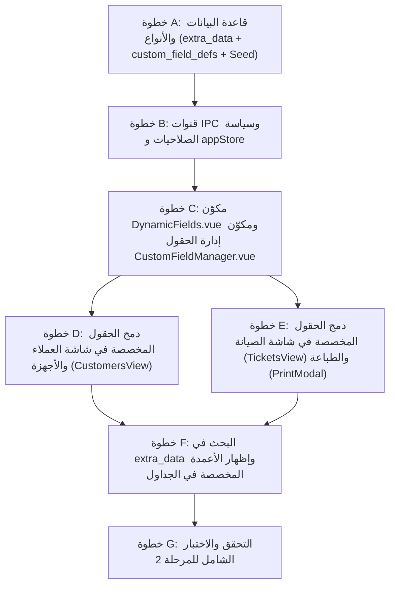

# خطة تنفيذ المرحلة 2 (تفصيلية): الحقول المخصصة لكل قطاع (Custom Fields)

مبنية على مراجعة الكود الفعلي بعد إتمام المرحلة 1. هذه الخطة تفصّل [02-phase-custom-fields.md](02-phase-custom-fields.md) وتحدد التعديلات الدقيقة وترتيب التنفيذ ومعايير التحقق.

---

## 0. اكتشافات من الكود الفعلي تُوجّه التنفيذ

| # | الاكتشاف في الكود الحالي | الأثر على التصميم والتنفيذ |
|---|--------------------------|----------------------------|
| 1 | الدالة `saveTicket` في [db.ts](../src/main/db.ts#L1593-L1637) تقوم تلقائياً بإنشاء أو تحديث سجل الجهاز في `customer_appliances` عند حفظ تذكرة صيانة. | عند حفظ تذكرة، يجب دمج أو تمرير حقول الجهاز المخصصة (أو عدم مسح `extra_data` الموجودة في `customer_appliances`)، وعند اختيار جهاز مسجل سابقاً في `TicketsView.vue` عبر `selectExistingAppliance` تُنسخ حقوله المخصصة إلى التذكرة أو تُعرض مرجعياً. |
| 2 | البحث في `listCustomers` و`listTickets` يعتمد على جمل `LIKE ?` على الأعمدة النصية المباشرة في SQLite. | بما أن `extra_data` يُحفظ كنص JSON (`TEXT DEFAULT '{}'`), فإن إضافة `OR c.extra_data LIKE ?` في `listCustomers` و`OR mt.extra_data LIKE ?` (أو البحث في أجهزة العميل) في `listTickets` يجعل البحث بالرقم التسلسلي للأذن اليمنى/اليسرى أو أي حقل مخصص يعمل فوراً وبسرعة بدون تعقيد. |
| 3 | `SettingsView.vue` يحتوي في أسفله على مكوّن `LookupManager.vue` لإدارة القوائم، ويديره المدراء (`super_admin`, `owner`, `tenant`). | نُنشئ مكوّن `CustomFieldManager.vue` بنفس روح وتصميم `LookupManager.vue` ونضعه في `SettingsView.vue`، مع تطبيق نفس صلاحية `manager` في `channelPolicy.ts` على قنوات الكتابة، و`authenticated` على قناة القراءة. |
| 4 | في قطاع السماعات (`hearing_aids`)، بعض خيارات الحقول المخصصة مثل «مقاس/نوع القالب» موجودة أصلاً في `lookup_items` تحت فئة `earmold_type`. | ندعم في تعريف الحقل من نوع `select` إما قائمة خيارات ثابتة (`options` كـ JSON array) أو ربطه بفئة من `lookup_items` (مثلاً `lookup:earmold_type`) لكي تتحدث الخيارات تلقائياً إذا أضاف المركز نوع قالب جديد. |
| 5 | `PrintModal.vue` يدعم قالبين: `a4` (رسمي) و`thermal80` (إيصال حراري 80mm). | تُعرض الحقول المخصصة غير الفارغة (للعميل، وللجهاز، وللتذكرة) بشكل منظم ومختصر في كلا القالبين (A4 و80mm) دون كسر تصميم الطباعة، ولا يظهر أي شيء إضافي إذا كانت `extra_data` فارغة (كما في قطاع `appliances`). |
| 6 | الكائنات التفاعلية في Vue (Reactive Proxies) تُحوَّل عبر `plain()` قبل إرسالها للـ IPC. | `extra_data` في الواجهة تكون `Record<string, any>`، وتُرسل ككائن JSON عادي عبر IPC، ويتولى `db.ts` تحويلها إلى نص عبر `JSON.stringify` عند الحفظ وإرجاعها ككائن عبر `parseJsonObject` عند القراءة. |

---

## 1. ترتيب التنفيذ



كل خطوة تُنجز وتُختبر بـ `npm run build` قبل الانتقال للخطوة التالية.

---

## الخطوة A: قاعدة البيانات والأنواع والـ Seed

### 1. الأنواع في [src/shared/types.ts](../src/shared/types.ts)
- تعريف أنواع الحقول المخصصة:
  ```ts
  export type CustomFieldEntity = 'customer' | 'device' | 'ticket'
  export type CustomFieldType = 'text' | 'number' | 'date' | 'select' | 'boolean' | 'textarea'

  export interface CustomFieldDef {
    id: number
    business_type: BusinessType
    entity: CustomFieldEntity
    key: string
    label: string
    type: CustomFieldType
    options: string[] // أو مصدر ديناميكي مثل ['@lookup:earmold_type']
    required: number // 1 أو 0
    show_in_table: number // 1 أو 0 (للبند 2.4: إظهار الحقل كعمود في الجدول)
    sort_order: number
    is_active: number // 1 أو 0
    created_at?: string
  }
  ```
- إضافة `extra_data?: Record<string, any>` إلى واجهات:
  - `Customer`
  - `CustomerAppliance`
  - `MaintenanceTicket`

### 2. الجداول والترقية (Migrations) في [src/main/db.ts](../src/main/db.ts)
- في `createTables()`:
  - إنشاء جدول `custom_field_defs`:
    ```sql
    CREATE TABLE IF NOT EXISTS custom_field_defs (
      id INTEGER PRIMARY KEY AUTOINCREMENT,
      business_type TEXT NOT NULL,
      entity TEXT NOT NULL CHECK(entity IN ('customer', 'device', 'ticket')),
      key TEXT NOT NULL,
      label TEXT NOT NULL,
      type TEXT NOT NULL CHECK(type IN ('text', 'number', 'date', 'select', 'boolean', 'textarea')),
      options TEXT NOT NULL DEFAULT '[]',
      required INTEGER NOT NULL DEFAULT 0,
      show_in_table INTEGER NOT NULL DEFAULT 0,
      sort_order INTEGER NOT NULL DEFAULT 0,
      is_active INTEGER NOT NULL DEFAULT 1,
      created_at TEXT NOT NULL DEFAULT (datetime('now', 'localtime')),
      UNIQUE(business_type, entity, key)
    );
    ```
- في `runMigrations()` (عبر `ensureColumn` الآمنة):
  - `ensureColumn('customers', 'extra_data', "TEXT NOT NULL DEFAULT '{}'")`
  - `ensureColumn('customer_appliances', 'extra_data', "TEXT NOT NULL DEFAULT '{}'")`
  - `ensureColumn('maintenance_tickets', 'extra_data', "TEXT NOT NULL DEFAULT '{}'")`

### 3. البيانات الافتراضية (Seed) لقطاع السماعات (`hearing_aids`)
تُضاف في `businessProfiles.ts` وتُزرع في `seedDefaults()` داخل `db.ts` (`INSERT OR IGNORE`) للكيان `device` في قطاع `hearing_aids`:
1. **`ear_side`** — «جهة الأذن»: نوع `select`، خيارات: `['يمين (Right)', 'يسار (Left)', 'الاثنان معاً (Bilateral)']`، إلزامي (`required = 1`)، يظهر في الجدول (`show_in_table = 1`).
2. **`serial_right`** — «الرقم التسلسلي - أذن يمين (R)»: نوع `text`، اختياري، يظهر في الجدول (`show_in_table = 1`).
3. **`serial_left`** — «الرقم التسلسلي - أذن يسار (L)»: نوع `text`، اختياري، يظهر في الجدول (`show_in_table = 1`).
4. **`earmold_spec`** — «مقاس / نوع القالب»: نوع `select`، خيارات مستمدة من قائمة القوالب أو خيارات افتراضية `['بدون قالب (Dome)', 'قالب كامل (Full Shell)', 'نصف قالب (Half Shell)', 'قالب مفرغ (Skeleton)', 'قالب قناة (Canal)', 'قالب مخصص']`.
5. **`company_warranty_start`** — «تاريخ بداية ضمان الشركة»: نوع `date`.
6. **`company_warranty_end`** — «تاريخ انتهاء ضمان الشركة»: نوع `date`، يظهر في الجدول (`show_in_table = 1`).
7. **`power_level`** — «مستوى القدرة (Power)»: نوع `select`، خيارات: `['Standard (عادي)', 'M (متوسط)', 'P (قوي - Power)', 'SP (فائق القوة - Super Power)', 'UP (Ultra Power)']`.

> ملاحظة: قطاع `appliances` لا يملك أي حقول مخصصة افتراضية (`[]`)، فلا يتأثر نهائياً.

### 4. دوال القراءة والحفظ في `db.ts`
- إضافة دالة مساعدة `parseJsonObject(raw: unknown): Record<string, any>` لتحويل النص المخزن في `extra_data` بأمان إلى كائن، ودالة `stringifyExtraData(obj: unknown): string`.
- تحديث:
  - `listCustomers`، `findCustomerByPhone`، `saveCustomer` لقراءة وحفظ `extra_data`.
  - `normalizeApplianceRow`، `saveCustomerAppliance` لقراءة وحفظ `extra_data`.
  - `normalizeTicketRow`، `saveTicket` لقراءة وحفظ `extra_data` (مع الحفاظ على `extra_data` الخاصة بالجهاز عند المزامنة مع `customer_appliances`).
- إضافة دوال إدارة تعريفات الحقول في `db.ts`:
  - `listCustomFieldDefs(entity?: CustomFieldEntity, businessType?: BusinessType): CustomFieldDef[]`
  - `saveCustomFieldDef(data: Partial<CustomFieldDef>): CustomFieldDef` (مع توليد `key` تلقائي آمن مثل `cf_171...` إذا لم يحدد المستخدم مفتاحاً برمجياً عند الإضافة من الإعدادات).
  - `deleteCustomFieldDef(id: number): void`
  - `reorderCustomFieldDefs(items: Array<{ id: number; sort_order: number }>): void`

---

## الخطوة B: قنوات IPC وسياسة الصلاحيات و `appStore`

1. **[src/main/channelPolicy.ts](../src/main/channelPolicy.ts):**
   - `'customFields:list': 'authenticated'`
   - `'customFields:save': 'manager'`
   - `'customFields:delete': 'manager'`
   - `'customFields:reorder': 'manager'`
2. **[src/main/index.ts](../src/main/index.ts) و [src/preload/index.ts](../src/preload/index.ts) و [src/preload/index.d.ts](../src/preload/index.d.ts) و [src/renderer/src/utils/webApiBridge.ts](../src/renderer/src/utils/webApiBridge.ts):**
   - ربط القنوات الأربع بحيث تعمل على سطح المكتب (Electron IPC) وعبر الشبكة المحلية والمتصفح (`webApiBridge`).
3. **[src/renderer/src/stores/appStore.ts](../src/renderer/src/stores/appStore.ts):**
   - إضافة `customFieldDefs = ref<CustomFieldDef[]>([])` ودالة `fetchCustomFields()`.
   - استدعاء `fetchCustomFields()` ضمن `loadSettings()` وعند تبديل النشاط.
   - إضافة دوال مساعدة (Getters):
     - `getActiveFields(entity: CustomFieldEntity): CustomFieldDef[]`
     - `getTableColumns(entity: CustomFieldEntity): CustomFieldDef[]` (الحقول النشطة التي تحمل `show_in_table === 1`).

---

## الخطوة C: مكوّن `DynamicFields.vue` ومكوّن الإدارة `CustomFieldManager.vue`

### 1. مكوّن `src/renderer/src/components/DynamicFields.vue`
- **المدخلات (Props):**
  - `entity: CustomFieldEntity` (`'customer' | 'device' | 'ticket'`)
  - `modelValue: Record<string, any>` (`v-model` لكائن `extra_data`)
  - `readonly?: boolean` (للعرض فقط في بطاقات التفاصيل)
- **الوظيفة:**
  - يجلب الحقول النشطة لهذا الـ `entity` من `appStore.getActiveFields(entity)`.
  - إذا لم توجد حقول نشطة (مثل قطاع `appliances` افتراضياً)، لا يرسم أي عنصر في الصفحة (`v-if="fields.length > 0"`).
  - يرسم كل حقل حسب نوعه (`text`, `number`, `date`, `select`, `boolean`, `textarea`) بتصميم متناسق مع بقية النماذج (Tailwind + الوضع الليلي).
  - يضع علامة `*` للحقول الإلزامية (`required === 1`).
  - يصدّر دالة تحقق `validateFields(entity, extraData): { valid: boolean; missingLabel?: string }` (في composable أو دالة مساعدة مشتركة `useCustomFields.ts`) لاستدعائها قبل الحفظ في النماذج.

### 2. مكوّن `src/renderer/src/components/CustomFieldManager.vue`
- يُضمَّن في [SettingsView.vue](../src/renderer/src/views/SettingsView.vue) أسفل `LookupManager.vue`.
- تبويبات حسب الكيان:
  - **حقول الأجهزة / السماعات (`device`)**
  - **حقول العملاء / المرضى (`customer`)**
  - **حقول طلبات الصيانة (`ticket`)**
- يتيح للمدير:
  - إضافة حقل جديد (تحديد الاسم الظاهر `label`، نوع الحقل `type`، الخيارات إن كان `select`، هل هو إلزامي `required`، هل يظهر كعمود في الجدول `show_in_table`، وترتيب الظهور).
  - تعديل أو تعطيل/تفعيل أو حذف أي حقل.

---

## الخطوة D: دمج الحقول المخصصة في شاشة العملاء والأجهزة (`CustomersView.vue`)

1. **نموذج إضافة/تعديل عميل (`modalOpen`):**
   - ربط `<DynamicFields entity="customer" v-model="form.extra_data" />`.
   - التحقق من الحقول الإلزامية عبر `validateCustomFields('customer', form.value.extra_data)` في `handleSaveCustomer()`.
2. **نموذج إضافة/تعديل جهاز أو سماعة للعميل (`applianceModalOpen`):**
   - ربط `<DynamicFields entity="device" v-model="applianceForm.extra_data" />`.
   - التحقق من الحقول الإلزامية في `handleSaveAppliance()`.
3. **نافذة سجل العميل (`historyModalOpen`):**
   - عرض قيم الحقول المخصصة غير الفارغة لكل جهاز/سماعة مسجلة كشارات (Badges) واضحة داخل بطاقة الجهاز (مثل: جهة الأذن، سيريال يمين/يسار، نوع القالب، ضمان الشركة، مستوى القدرة).

---

## الخطوة E: دمج الحقول المخصصة في شاشة الصيانة (`TicketsView.vue`) والطباعة (`PrintModal.vue`)

1. **نموذج طلب الصيانة في `TicketsView.vue`:**
   - في قسم بيانات الجهاز وتفاصيل الخدمة: عرض `<DynamicFields entity="device" v-model="form.extra_data" />` و`<DynamicFields entity="ticket" v-model="form.extra_data" />` (أو دمج الحقول النشطة للجهاز والتذكرة بحيث يستطيع مدخل الطلب تعبئة جهة الأذن/السيريال أو أي حقل مخصص للتذكرة مباشرة).
   - عند اختيار جهاز مسجل سابقاً للعميل (`selectExistingAppliance(app)`)، تُنسخ قيم `app.extra_data` تلقائياً إلى `form.value.extra_data` لتوفير الوقت.
   - التحقق من الحقول الإلزامية قبل الحفظ في `handleSaveTicket()`.
2. **معاينة الطباعة (`PrintModal.vue`):**
   - استخراج الحقول المخصصة ذات القيم غير الفارغة من `ticket.extra_data` ومطابقتها مع `customFieldDefs` لعرض `label: value`.
   - عرضها في **قالب A4 الرسمي** داخل صندوق بيانات الجهاز/العميل، وفي **قالب الإيصال الحراري 80mm** بشكل مدمج وأنيق.

---

## الخطوة F: البحث في `extra_data` وإظهار الأعمدة المخصصة في الجداول (البند 2.4)

1. **البحث الشامل (`db.ts`):**
   - في `listCustomers(search)`: توسيع جملة `WHERE` لتشمل:
     - `OR c.extra_data LIKE ?`
     - `OR EXISTS (SELECT 1 FROM customer_appliances ca WHERE ca.customer_id = c.id AND (ca.serial_number LIKE ? OR ca.extra_data LIKE ?))`
     - وبذلك عند كتابة الرقم التسلسلي لأي أذن في بحث العملاء، يظهر العميل صاحب السماعة فوراً!
   - في `listTickets(filters)`: توسيع جملة `WHERE` لتشمل:
     - `OR mt.extra_data LIKE ?`
2. **الأعمدة الديناميكية في الجداول (`show_in_table`):**
   - في `CustomersView.vue`: إضافة أعمدة ديناميكية في جدول العملاء للحقول التي تحمل `entity === 'customer' && show_in_table === 1`، وعرض شارات الحقول البارزة للأجهزة.
   - في `TicketsView.vue`: عرض الحقول التي تحمل `show_in_table === 1` (مثل جهة الأذن أو السيريال المخصص) داخل جدول التذاكر أو كأعمدة إضافية.

---

## الخطوة G: التحقق والاختبار النهائي (معايير القبول)

- [ ] `npm run build` يمر بنجاح (Typecheck لـ node وweb بدون أي أخطاء).
- [ ] **قطاع الأجهزة الكهربائية (`appliances`):** لا يظهر أي حقل إضافي افتراضياً في العملاء أو الأجهزة أو التذاكر أو الطباعة.
- [ ] **قطاع السماعات الطبية (`hearing_aids`):**
  - تظهر الحقول الـ 7 الافتراضية للسماعة (جهة الأذن، الرقم التسلسلي لكل أذن، مقاس/نوع القالب، بداية وانتهاء ضمان الشركة، مستوى القدرة).
  - التحقق من الحقل الإلزامي (مثل جهة الأذن) يمنع الحفظ عند تركه فارغاً ويعرض تنبيهاً واضحاً.
  - حفظ السماعة والتذكرة يحفظ `extra_data` وتظهر القيم في سجل العميل وفي شاشة الطباعة (A4 و80mm).
- [ ] **البحث:** البحث بالرقم التسلسلي لأي أذن في شاشة العملاء أو شاشة التذاكر يعثر على السجل فوراً.
- [ ] **الإعدادات:** إضافة حقل مخصص جديد من «إعدادات المركز ← إدارة الحقول المخصصة» (مع خيار إظهاره في الجدول) يظهر فوراً في النماذج والجداول دون تعديل أي كود.
- [ ] تحديث حالة المرحلة 2 في `docs/00-README.md` إلى `✅ مكتملة` بعد اجتياز جميع الاختبارات.
