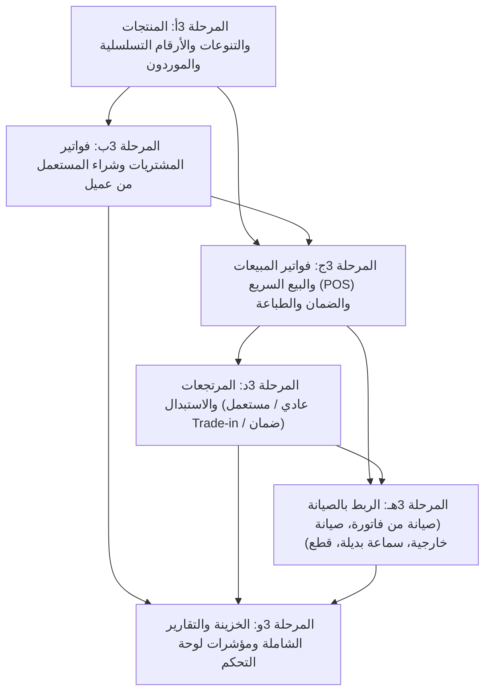

# خطة تنفيذ المرحلة 3 (تفصيلية): المبيعات والمشتريات والموردون (قطاع السماعات فقط)

مبنية على مراجعة الكود الفعلي بعد إتمام المرحلتين 1 و2. هذه الخطة تفصّل [03-phase-sales-purchases.md](03-phase-sales-purchases.md) وتقسّم العمل إلى المراحل الفرعية الست (**3أ ← 3و**) مع تحديد الجداول، الأنواع، قنوات الـ IPC، الشاشات، ومعايير التحقق لكل مرحلة فرعية.

---

## 0. اكتشافات من الكود الفعلي تُوجّه التصميم والتنفيذ

| # | الاكتشاف في الكود الحالي | الأثر على التصميم والتنفيذ |
|---|--------------------------|----------------------------|
| 1 | جدول `spare_parts` و`inventory_movements` الحاليان مصممان لقطع الغيار البسيطة، و`inventory_movements.part_id` مربوط بمفتاح أجنبي إلزامي `NOT NULL REFERENCES spare_parts(id)`. | نُنشئ جداول المنتجات الجديدة (`products`، `product_variants`، `product_serials`)، ونُرقّي جدول `inventory_movements` في `runMigrations()` ليصبح `part_id` اختيارياً (`NULL`) مع إضافة أعمدة `product_id` و`variant_id` و`serial_no` و`ref_type` و`ref_id` لتوثيق كل حركة بيع/شراء/مرتجع/استبدال/صيانة في سجل الحركات الموحد دون كسر قطاع `appliances`. |
| 2 | البطاريات في مراكز السماعات تُشترى وتُباع بـ **العبوة (الشريط = 6 حجارة مثلاً)** أو بـ **القطعة المنفردة (الحجر)** مع تنبيه نقص لكل مقاس (`10, 312, 13, 675...`). | لتفادي الكسور العشرية ومشاكل التقريب في المخزون، يُخزَّن الرصيد (`qty` و`min_stock`) في `products` و`product_variants` **بأصغر وحدة (القطعة/الحجر)** كعدد صحيح (`INTEGER`)، مع حقل `pack_size` (افتراضياً `6` للبطاريات و`1` لغيرها) و`pack_sale_price` و`pack_cost_price`. عند بيع/شراء عبوة يُضرب العدد في `pack_size` تلقائياً، وتُعرض الكمية في الواجهة بصيغة مزدوجة واضحة (مثلاً: `52 قطعة (8 عبوة + 4 قطعة)`). |
| 3 | الدالة `saveTicket` في [db.ts](../src/main/db.ts#L1700-L1751) تقوم تلقائياً بمزامنة سجل الجهاز في `customer_appliances`. | عند بيع سماعة أو معالج قوقعة برقم تسلسلي لعميل في فاتورة المبيعات (`saveSalesInvoice`)، نقوم تلقائياً بإنشاء سجل في `customer_appliances` للعميل مع تعبئة الماركة والموديل والرقم التسلسلي (`serial_right` أو `serial_left` في `extra_data`) وتاريخ انتهاء الضمان، ليظهر الجهاز فوراً في ملف المريض وعند فتح طلب صيانة لاحقاً. |
| 4 | جدول `treasury_transactions` في [db.ts](../src/main/db.ts#L418-L428) يحتوي على قيد `CHECK(transaction_type IN ('income', 'expense', 'tech_commission'))` ويرتبط بـ `ticket_id` و`technician_id`. | نحافظ على أنواع الحركات الثلاثة (`income` للمبيعات وتحصيل الأقساط ومرتجع المشتريات، و`expense` للمشتريات وسداد الموردين وشراء المستعمل ومرتجع المبيعات)، ونضيف أعمدة مرجعية اختيارية (`sales_invoice_id`، `purchase_invoice_id`، `supplier_id`، `customer_id`) عبر `ensureColumn` لربط كل قيد خزينة بمصدره بدقة. |
| 5 | جدول `maintenance_tickets` لا يحتوي على قيد `CHECK` على عمود `status` في SQLite، والحالات معرّفة في `types.ts` و`TICKET_STATUS_MAP` في [appliances.ts](../src/renderer/src/constants/appliances.ts). | يمكن إضافة حالتَي الصيانة الخارجية (`sent_to_lab`: «أُرسلت للشركة / المعمل»، `returned_from_lab`: «عادت من الشركة / المعمل») بسلاسة دون الحاجة لإعادة بناء جدول `maintenance_tickets`، مع إظهار هاتين الحالتين في فلاتر ونماذج قطاع `hearing_aids`. |
| 6 | الدالة `isBusinessDataEmpty()` في [db.ts](../src/main/db.ts#L2394-L2428) تفحص الجداول الأساسية قبل السماح بتبديل النشاط بدون كلمة مرور. | نُضيف الجداول الجديدة (`products`، `suppliers`، `purchase_invoices`، `sales_invoices`) إلى قائمة الفحص في `isBusinessDataEmpty()`. |
| 7 | `PrintModal.vue` مصمم حالياً لطباعة تذكرة صيانة (`ticketToPrint`). | نوسّع `PrintModal.vue` و`appStore.ts` لدعم طباعة **فاتورة مبيعات + شهادة ضمان السماعة** و**إيصال استبدال/مرتجع** بكلا القالبين (`a4` و`thermal80`). |
| 8 | الدقة المحاسبية (مخاطر الفواصل العائمة في JavaScript مثل `0.1 + 0.2`). | نُعرّف دالة موحدة `roundMoney(n: number): number` تقرّب لأقرب قرشين (`Math.round((n + Number.EPSILON) * 100) / 100`) وتُستخدم في جميع العمليات الحسابية في `db.ts` والواجهات. |

---

## 1. خارطة المراحل الفرعية وترتيب التنفيذ

تُنفَّذ المراحل الفرعية بالترتيب، وكل مرحلة فرعية تنتهي ببناء ناجح (`npm run build`) واختبار يدوي لمعايير قبولها قبل الانتقال للتالية:



### تفعيل الوحدات في `businessProfiles.ts` و`App.vue` و`router/index.ts`
- تُضاف الوحدات: `'products'`، `'suppliers'`، `'purchases'`، `'sales'` إلى مصفوفة `modules` في `HEARING_AIDS_PROFILE` فقط داخل [src/shared/businessProfiles.ts](../src/shared/businessProfiles.ts).
- تبقى مصفوفة `APPLIANCES_PROFILE.modules` كما هي تماماً، فلا يظهر أي مسار أو زر من المرحلة 3 في قطاع الأجهزة الكهربائية.
- صلاحيات الأدوار (`channelPolicy.ts` و`App.vue`):
  - **المنتجات والمخزون (`products`):** متاحة للمدراء وأمين المخزن والكاشير (`inventory` / `authenticated` للقراءة في الفواتير).
  - **الموردون والمشتريات (`suppliers`، `purchases`):** متاحة للمدراء وأمين المخزن والمحاسب (`inventory` / `financial`).
  - **المبيعات والبيع السريع والمرتجعات (`sales`):** متاحة للمدراء والكاشير وموظف الاستقبال.

---

## 2. المرحلة الفرعية 3أ: المنتجات والتنوعات والأرقام التسلسلية والموردون

### 2.1 قاعدة البيانات (`src/main/db.ts`)

1. **جدول المنتجات `products`:**
   ```sql
   CREATE TABLE IF NOT EXISTS products (
     id INTEGER PRIMARY KEY AUTOINCREMENT,
     code TEXT NOT NULL UNIQUE,
     barcode TEXT DEFAULT '',
     name TEXT NOT NULL,
     type TEXT NOT NULL CHECK(type IN ('hearing_aid', 'cochlear_processor', 'cochlear_part', 'battery', 'accessory', 'earmold', 'service')),
     sub_category TEXT DEFAULT '',
     brand TEXT DEFAULT '',
     model TEXT DEFAULT '',
     compatible_with TEXT DEFAULT '', -- ماركات/موديلات متوافقة (للإكسسوارات وقطع القوقعة)
     track_serial INTEGER NOT NULL DEFAULT 0, -- 1 للسماعات ومعالجات القوقعة، 0 للباقي
     has_variants INTEGER NOT NULL DEFAULT 0, -- 1 للبطاريات والإكسسوارات متعددة المقاسات/الألوان
     unit_name TEXT NOT NULL DEFAULT 'قطعة',
     pack_name TEXT DEFAULT 'عبوة',
     pack_size INTEGER NOT NULL DEFAULT 1, -- مثلاً 6 قطع للشريط في البطاريات
     cost_price REAL NOT NULL DEFAULT 0, -- تكلفة القطعة الواحدة
     sale_price REAL NOT NULL DEFAULT 0, -- سعر بيع القطعة الواحدة
     pack_cost_price REAL NOT NULL DEFAULT 0, -- تكلفة العبوة
     pack_sale_price REAL NOT NULL DEFAULT 0, -- سعر بيع العبوة
     qty INTEGER NOT NULL DEFAULT 0, -- الرصيد الإجمالي بالقطعة
     min_stock INTEGER NOT NULL DEFAULT 3, -- حد التنبيه بالقطعة
     warranty_months INTEGER NOT NULL DEFAULT 12,
     image_base64 TEXT DEFAULT '',
     notes TEXT DEFAULT '',
     extra_data TEXT NOT NULL DEFAULT '{}',
     is_active INTEGER NOT NULL DEFAULT 1,
     created_at TEXT NOT NULL DEFAULT (datetime('now', 'localtime'))
   );
   ```

2. **جدول تنوعات المنتج `product_variants` (مقاسات البطاريات وألوان/مقاسات الإكسسوارات):**
   ```sql
   CREATE TABLE IF NOT EXISTS product_variants (
     id INTEGER PRIMARY KEY AUTOINCREMENT,
     product_id INTEGER NOT NULL,
     variant_name TEXT NOT NULL, -- مثلاً: مقاس 312 (بني)
     size TEXT DEFAULT '',
     color TEXT DEFAULT '',
     sku TEXT DEFAULT '',
     barcode TEXT DEFAULT '',
     cost_price REAL DEFAULT NULL, -- إن ترك NULL يتبع سعر المنتج الأب
     sale_price REAL DEFAULT NULL,
     pack_cost_price REAL DEFAULT NULL,
     pack_sale_price REAL DEFAULT NULL,
     qty INTEGER NOT NULL DEFAULT 0, -- بالقطعة
     min_stock INTEGER NOT NULL DEFAULT 6, -- بالقطعة
     is_active INTEGER NOT NULL DEFAULT 1,
     FOREIGN KEY (product_id) REFERENCES products(id) ON DELETE CASCADE
   );
   ```

3. **جدول الأرقام التسلسلية `product_serials` (للسماعات ومعالجات القوقعة):**
   ```sql
   CREATE TABLE IF NOT EXISTS product_serials (
     id INTEGER PRIMARY KEY AUTOINCREMENT,
     product_id INTEGER NOT NULL,
     variant_id INTEGER DEFAULT NULL,
     serial_no TEXT NOT NULL UNIQUE,
     status TEXT NOT NULL DEFAULT 'in_stock'
       CHECK(status IN ('in_stock', 'sold', 'returned', 'defective', 'loaned', 'external_repair')),
     condition TEXT NOT NULL DEFAULT 'new'
       CHECK(condition IN ('new', 'used')),
     purchase_item_id INTEGER DEFAULT NULL,
     sale_item_id INTEGER DEFAULT NULL,
     customer_id INTEGER DEFAULT NULL,
     ear_side TEXT DEFAULT '',
     company_warranty_start TEXT DEFAULT NULL,
     company_warranty_end TEXT DEFAULT NULL,
     customer_warranty_start TEXT DEFAULT NULL,
     customer_warranty_end TEXT DEFAULT NULL,
     notes TEXT DEFAULT '',
     created_at TEXT NOT NULL DEFAULT (datetime('now', 'localtime')),
     FOREIGN KEY (product_id) REFERENCES products(id) ON DELETE RESTRICT
   );
   ```

4. **جدول الموردين `suppliers` وحركات سداد الموردين `supplier_payments`:**
   ```sql
   CREATE TABLE IF NOT EXISTS suppliers (
     id INTEGER PRIMARY KEY AUTOINCREMENT,
     name TEXT NOT NULL,
     company_name TEXT DEFAULT '',
     phone TEXT NOT NULL,
     phone2 TEXT DEFAULT '',
     address TEXT DEFAULT '',
     supplier_type TEXT NOT NULL DEFAULT 'company' CHECK(supplier_type IN ('company', 'customer')),
     customer_id INTEGER DEFAULT NULL,
     balance REAL NOT NULL DEFAULT 0, -- الرصيد المستحق للمورد (دائن)
     notes TEXT DEFAULT '',
     is_active INTEGER NOT NULL DEFAULT 1,
     created_at TEXT NOT NULL DEFAULT (datetime('now', 'localtime'))
   );

   CREATE TABLE IF NOT EXISTS supplier_payments (
     id INTEGER PRIMARY KEY AUTOINCREMENT,
     supplier_id INTEGER NOT NULL,
     purchase_invoice_id INTEGER DEFAULT NULL,
     amount REAL NOT NULL,
     payment_method TEXT NOT NULL DEFAULT 'cash',
     treasury_tx_id INTEGER DEFAULT NULL,
     notes TEXT DEFAULT '',
     created_at TEXT NOT NULL DEFAULT (datetime('now', 'localtime')),
     FOREIGN KEY (supplier_id) REFERENCES suppliers(id) ON DELETE RESTRICT
   );
   ```

5. **ترقية `inventory_movements` في `runMigrations()`:**
   - تحويل `part_id` ليقبل `NULL` (عندما تكون الحركة على `product_id`)، وإضافة الأعمدة:
     - `product_id INTEGER DEFAULT NULL`
     - `variant_id INTEGER DEFAULT NULL`
     - `serial_no TEXT DEFAULT ''`
     - `ref_type TEXT DEFAULT ''` (`'purchase' | 'sale' | 'return' | 'exchange' | 'ticket' | 'manual'`)
     - `ref_id INTEGER DEFAULT NULL`

### 2.2 الأنواع وقنوات الـ IPC (3أ)
- تعريف الواجهات في `src/shared/types.ts`: `Product`, `ProductType`, `ProductVariant`, `ProductSerial`, `SerialStatus`, `Supplier`, `SupplierPayment`, `SupplierStatement`.
- قنوات الـ IPC في `index.ts`، `channelPolicy.ts`، `preload/index.ts`، `webApiBridge.ts`:
  - `products:list`، `products:getByBarcode`، `products:save`، `products:delete`
  - `products:serials:list`، `products:serials:add`، `products:serials:updateStatus`
  - `products:adjustStock` (لتسوية المخزون الأولي أو اليدوي بالعبوة/القطعة)
  - `suppliers:list`، `suppliers:save`، `suppliers:delete`، `suppliers:statement`، `suppliers:pay`

### 2.3 الشاشات (3أ)
1. **شاشة المنتجات والأرقام التسلسلية `src/renderer/src/views/ProductsView.vue`:**
   - تبويبات سريعة حسب النوع: «الكل»، «السماعات الطبية»، «أجهزة وقطع القوقعة»، «البطاريات (بالمقاسات)»، «الإكسسوارات والقوالب»، «الخدمات (برمجة/قالب/تنظيف)».
   - نموذج إضافة/تعديل منتج:
     - يضبط تلقائياً `track_serial = 1` عند اختيار سماعة أو معالج قوقعة، و`has_variants = 1` و`pack_size = 6` عند اختيار بطارية.
     - قسم «التنوعات / المقاسات» (`product_variants`) مع زر «توليد مقاسات البطاريات القياسية (10، 312، 13، 675)» بضغطة واحدة.
     - حقل «متوافق مع (ماركات/موديلات)» للإكسسوارات وقطع القوقعة، والتصنيف الفرعي من قوائم `lookup_items` (`accessory_type` / `implant_part`).
   - نافذة إدارة الأرقام التسلسلية لكل منتج (`product_serials`): عرض الأرقام المتاحة والمباعة والمعيبة والمعارة، وإضافة أرقام تسلسلية للرصيد الافتتاحي، والبحث الفوري بالرقم التسلسلي.
2. **شاشة الموردين `src/renderer/src/views/SuppliersView.vue`:**
   - قائمة الموردين والشركات مع إجمالي المستحقات (`balance`).
   - نافذة إضافة/تعديل مورد.
   - نافذة **كشف حساب مورد** (الفواتير + المدفوعات + المرتجعات + الرصيد المتحرك).
   - نافذة **سداد دفعة لمورد** (تخصم من رصيد المورد وتُسجل منصرفاً في الخزينة داخل `runTransaction`).

### 2.4 معيار قبول المرحلة الفرعية 3أ
- [ ] إنشاء منتج بطارية بتنوعات المقاسات (10، 312، 13، 675) وحجم عبوة 6 قطع، وإنشاء سماعة ومعالج قوقعة يتتبعان الرقم التسلسلي، وإنشاء خدمة (برمجة/قالب) بلا مخزون.
- [ ] إضافة مورد وعرض كشف حسابه وتسجيل دفعة سداد له.
- [ ] لا تظهر شاشات المنتجات أو الموردين في قطاع `appliances`.

---

## 3. المرحلة الفرعية 3ب: المشتريات وشراء المستعمل من عميل

### 3.1 قاعدة البيانات (`src/main/db.ts`)

1. **جدول فواتير المشتريات `purchase_invoices`:**
   ```sql
   CREATE TABLE IF NOT EXISTS purchase_invoices (
     id INTEGER PRIMARY KEY AUTOINCREMENT,
     invoice_number TEXT NOT NULL UNIQUE,
     purchase_type TEXT NOT NULL DEFAULT 'supplier' CHECK(purchase_type IN ('supplier', 'used_from_customer')),
     supplier_id INTEGER DEFAULT NULL,
     customer_id INTEGER DEFAULT NULL, -- عند شراء سماعة مستعملة من عميل
     party_name TEXT NOT NULL,
     party_phone TEXT DEFAULT '',
     invoice_date TEXT NOT NULL DEFAULT (date('now', 'localtime')),
     supplier_ref_no TEXT DEFAULT '', -- رقم فاتورة المورد الورقية
     subtotal REAL NOT NULL DEFAULT 0,
     discount REAL NOT NULL DEFAULT 0,
     total_amount REAL NOT NULL DEFAULT 0,
     paid_amount REAL NOT NULL DEFAULT 0,
     remaining_amount REAL NOT NULL DEFAULT 0,
     payment_method TEXT NOT NULL DEFAULT 'cash',
     status TEXT NOT NULL DEFAULT 'completed' CHECK(status IN ('completed', 'partial_return', 'returned', 'cancelled')),
     notes TEXT DEFAULT '',
     created_at TEXT NOT NULL DEFAULT (datetime('now', 'localtime')),
     FOREIGN KEY (supplier_id) REFERENCES suppliers(id) ON DELETE RESTRICT,
     FOREIGN KEY (customer_id) REFERENCES customers(id) ON DELETE SET NULL
   );
   ```

2. **جدول بنود المشتريات `purchase_items`:**
   ```sql
   CREATE TABLE IF NOT EXISTS purchase_items (
     id INTEGER PRIMARY KEY AUTOINCREMENT,
     invoice_id INTEGER NOT NULL,
     product_id INTEGER NOT NULL,
     variant_id INTEGER DEFAULT NULL,
     product_name TEXT NOT NULL,
     unit TEXT NOT NULL DEFAULT 'piece' CHECK(unit IN ('piece', 'pack')),
     pack_size INTEGER NOT NULL DEFAULT 1,
     quantity INTEGER NOT NULL DEFAULT 1, -- العدد بالوحدة المختارة
     added_pieces_qty INTEGER NOT NULL DEFAULT 1, -- الكمية المضافة فعلياً للمخزون بالقطعة (quantity * pack_size)
     unit_cost REAL NOT NULL DEFAULT 0,
     total_cost REAL NOT NULL DEFAULT 0,
     condition TEXT NOT NULL DEFAULT 'new' CHECK(condition IN ('new', 'used')),
     serials_json TEXT NOT NULL DEFAULT '[]', -- الأرقام التسلسلية المدخلة لهذا البند
     company_warranty_end TEXT DEFAULT NULL,
     returned_qty INTEGER NOT NULL DEFAULT 0,
     FOREIGN KEY (invoice_id) REFERENCES purchase_invoices(id) ON DELETE CASCADE,
     FOREIGN KEY (product_id) REFERENCES products(id) ON DELETE RESTRICT
   );
   ```

### 3.2 منطق حفظ فاتورة الشراء (`savePurchaseInvoice` داخل `runTransaction`)
1. التحقق من أنه لكل بند يتتبع الرقم التسلسلي (`track_serial = 1`)، عدد الأرقام التسلسلية المدخلة يساوي `added_pieces_qty`، وعدم تكرار أي رقم تسلسلي موجود حالياً في المخزون.
2. إذا كان رقم تسلسلي موجوداً سابقاً بحالة `returned` (أو في حالة شراء مستعمل سبق بيعه وإرجاعه)، يُعاد تفعيله بحالة `in_stock` و`condition = 'used' | 'new'`، وإلا يُدرج سجل جديد في `product_serials`.
3. زيادة كمية المخزون في `product_variants.qty` (إن وجد تنوع) وفي `products.qty` بمقدار `added_pieces_qty`، وتحديث `cost_price` بآخر سعر شراء.
4. تسجيل حركة `in` في `inventory_movements` مع `ref_type = 'purchase'`.
5. **المعالجة المالية:**
   - إذا كان `paid_amount > 0`: تسجيل حركة `expense` في `treasury_transactions` (فئة `'فواتير مشتريات'` أو `'شراء سماعة مستعملة من عميل'`).
   - إذا كان `purchase_type === 'supplier'` و`remaining_amount > 0`: زيادة رصيد المورد `suppliers.balance` بمقدار `remaining_amount`.

### 3.3 الشاشة (3ب): `src/renderer/src/views/PurchasesView.vue`
- وضعان واضحان لإنشاء الفاتورة:
  1. **فاتورة توريد / شراء من مورد:** اختيار المورد، الأصناف (مع دعم الشراء بالعبوة أو بالقطعة للبطاريات)، إدخال الأرقام التسلسلية للسماعات (يدوياً أو بقارئ الباركود السريع سطراً بسطر) مع تاريخ انتهاء ضمان الشركة، وتحديد طريقة الدفع (نقدي كلي / آجل بالكامل / دفعة جزئية).
  2. **شراء سماعة مستعملة من عميل:** اختيار العميل (أو إدخال بياناته)، اختيار موديل السماعة، إدخال الرقم التسلسلي ونتيجة الفحص، تحديد سعر الشراء وطريقة الصرف من الخزينة، فتدخل السماعة المخزون بحالة `used` (`مستعمل`) جاهزة لإعادة البيع.
- جدول سجل فواتير المشتريات مع عرض التفاصيل وزر سداد المتبقي للمورد.

### 3.4 معيار قبول المرحلة الفرعية 3ب
- [ ] فاتورة شراء نقدي/آجل/جزئي تزيد المخزون بالقطعة والعبوة، وتدرج الأرقام التسلسلية بحالة `in_stock`، وتحدّث رصيد المورد والخزينة بدقة.
- [ ] فاتورة «شراء مستعمل من عميل» تدخل السماعة المخزون بحالة `used` وتخصم المبلغ من الخزينة.

---

## 4. المرحلة الفرعية 3ج: المبيعات والبيع السريع (POS) والضمان والطباعة

### 4.1 قاعدة البيانات (`src/main/db.ts`)

1. **جدول فواتير المبيعات `sales_invoices`:**
   ```sql
   CREATE TABLE IF NOT EXISTS sales_invoices (
     id INTEGER PRIMARY KEY AUTOINCREMENT,
     invoice_number TEXT NOT NULL UNIQUE,
     invoice_type TEXT NOT NULL DEFAULT 'regular' CHECK(invoice_type IN ('regular', 'quick_pos', 'exchange')),
     customer_id INTEGER DEFAULT NULL, -- NULL مسموح في البيع السريع quick_pos
     customer_name TEXT NOT NULL DEFAULT 'عميل نقدي (بيع سريع)',
     customer_phone TEXT DEFAULT '',
     subtotal REAL NOT NULL DEFAULT 0,
     discount REAL NOT NULL DEFAULT 0,
     trade_in_credit REAL NOT NULL DEFAULT 0, -- قيمة خصم سماعة مستعملة أو استبدال في المرحلة 3د
     total_amount REAL NOT NULL DEFAULT 0,
     paid_amount REAL NOT NULL DEFAULT 0,
     remaining_amount REAL NOT NULL DEFAULT 0,
     payment_method TEXT NOT NULL DEFAULT 'cash',
     status TEXT NOT NULL DEFAULT 'completed' CHECK(status IN ('completed', 'partial_return', 'returned', 'cancelled')),
     parent_invoice_id INTEGER DEFAULT NULL,
     notes TEXT DEFAULT '',
     extra_data TEXT NOT NULL DEFAULT '{}',
     created_at TEXT NOT NULL DEFAULT (datetime('now', 'localtime')),
     updated_at TEXT NOT NULL DEFAULT (datetime('now', 'localtime')),
     FOREIGN KEY (customer_id) REFERENCES customers(id) ON DELETE SET NULL
   );
   ```

2. **جدول بنود المبيعات `sales_items`:**
   ```sql
   CREATE TABLE IF NOT EXISTS sales_items (
     id INTEGER PRIMARY KEY AUTOINCREMENT,
     invoice_id INTEGER NOT NULL,
     product_id INTEGER NOT NULL,
     variant_id INTEGER DEFAULT NULL,
     product_name TEXT NOT NULL,
     variant_name TEXT DEFAULT '',
     item_type TEXT NOT NULL,
     unit TEXT NOT NULL DEFAULT 'piece' CHECK(unit IN ('piece', 'pack')),
     pack_size INTEGER NOT NULL DEFAULT 1,
     quantity INTEGER NOT NULL DEFAULT 1,
     deducted_pieces_qty INTEGER NOT NULL DEFAULT 1, -- الكمية المخصومة فعلياً بالقطعة
     serial_id INTEGER DEFAULT NULL,
     serial_no TEXT DEFAULT '',
     condition TEXT DEFAULT 'new',
     ear_side TEXT DEFAULT '', -- 'يمين (Right)' | 'يسار (Left)' | ''
     unit_cost REAL NOT NULL DEFAULT 0, -- لحساب مجمل الربح بدقة
     unit_price REAL NOT NULL DEFAULT 0,
     discount REAL NOT NULL DEFAULT 0,
     total_price REAL NOT NULL DEFAULT 0,
     warranty_months INTEGER NOT NULL DEFAULT 0,
     warranty_start TEXT DEFAULT NULL,
     warranty_end TEXT DEFAULT NULL,
     returned_qty INTEGER NOT NULL DEFAULT 0,
     FOREIGN KEY (invoice_id) REFERENCES sales_invoices(id) ON DELETE CASCADE,
     FOREIGN KEY (product_id) REFERENCES products(id) ON DELETE RESTRICT
   );
   ```

3. **جدول دفعات وأقساط المبيعات `sales_payments`:**
   ```sql
   CREATE TABLE IF NOT EXISTS sales_payments (
     id INTEGER PRIMARY KEY AUTOINCREMENT,
     invoice_id INTEGER NOT NULL,
     customer_id INTEGER DEFAULT NULL,
     amount REAL NOT NULL,
     payment_method TEXT NOT NULL DEFAULT 'cash',
     payment_type TEXT NOT NULL DEFAULT 'initial' CHECK(payment_type IN ('initial', 'installment', 'refund', 'exchange_diff')),
     treasury_tx_id INTEGER DEFAULT NULL,
     notes TEXT DEFAULT '',
     created_at TEXT NOT NULL DEFAULT (datetime('now', 'localtime')),
     FOREIGN KEY (invoice_id) REFERENCES sales_invoices(id) ON DELETE CASCADE
   );
   ```

### 4.2 منطق حفظ فاتورة البيع (`saveSalesInvoice` داخل `runTransaction`)
1. **للأصناف ذات الرقم التسلسلي (`track_serial = 1`):**
   - التحقق من أن `serial_no` موجود في `product_serials` وأن حالته `status === 'in_stock'` (منع بيع رقم تسلسلي مباع أو معيب أو معار).
   - تحديث `product_serials`: `status = 'sold'`، `sale_item_id`، `customer_id`، `ear_side`، `customer_warranty_start = today`، `customer_warranty_end = today + warranty_months`.
   - إذا كان هناك عميل محدد (`customer_id`)، يُنشأ/يُحدَّث سجل في `customer_appliances` للعميل تلقائياً مع الرقم التسلسلي وجهة الأذن وتاريخ انتهاء الضمان.
2. **لأصناف الكمية والبطاريات (`track_serial = 0` و`type !== 'service'`):**
   - حساب `deducted_pieces_qty = quantity * (unit === 'pack' ? pack_size : 1)`.
   - التحقق من كفاية الرصيد في `product_variants.qty` (أو `products.qty`)، وخصم الكمية.
3. **للخدمات (`type === 'service'` مثل برمجة، قالب، فحص):**
   - تُضاف في الفاتورة وتُحتسب في الإجمالي دون خصم أي مخزون (`deducted_pieces_qty = 0`).
4. **الأقساط والدفعات والخزينة:**
   - البيع السريع بدون عميل (`quick_pos`) يشترط دفع كامل المبلغ نقداً أو بمحفظة (`remaining_amount === 0`).
   - الفاتورة العادية بعميل تسمح بدفعة مقدمة والباقي رصيد مستحق على العميل (`remaining_amount > 0`) مع إمكانية تحصيل دفعات/أقساط لاحقة عبر `sales:collectInstallment` التي تحدّث `sales_invoices` و`sales_payments` و`treasury_transactions`.

### 4.3 الشاشة (3ج): `src/renderer/src/views/SalesView.vue` والطباعة في `PrintModal.vue`
- تحتوي `SalesView.vue` على 3 تبويبات رئيسية:
  1. **بيع سريع (POS - بطاريات وإكسسوارات بدون عميل):**
     - حقل باركود سريع في الأعلى (يركّز تلقائياً ويضيف الصنف بمجرد المسح).
     - أزرار سريعة لمقاسات البطاريات (`10 أصفر`، `312 بني`، `13 برتقالي`، `675 أزرق`، `675 قوقعة`) مع زرَي «+ شريط/عبوة» و«+ حجر/قطعة» لكل مقاس، وتنبيه لوني إذا كان المقاس ناقصاً.
     - سلة فورية على اليسار وزر «دفع وطباعة إيصال فوري (F9)».
  2. **فاتورة بيع مفصلة (سماعات / قوقعة / خدمات للمريض):**
     - اختيار المريض/العميل (أو إنشاء مريض جديد سريعاً).
     - إضافة سماعة مع اختيار الرقم التسلسلي المتاح من قائمة منسدلة ذكية (توضح إن كانت السماعة `جديدة` أو `مستعملة` وتاريخ ضمان الشركة) وتحديد جهة الأذن (`يمين R` / `يسار L`) ومدة الضمان بالشهور.
     - إضافة خدمات (برمجة، قالب) أو ملحقات مجانية/مدفوعة مع الفاتورة.
     - تحديد الخصم، المبلغ المدفوع، المتبقي (أقساط)، وطريقة الدفع.
  3. **سجل فواتير المبيعات وتحصيل الأقساط:**
     - بحث برقم الفاتورة، اسم المريض، الهاتف، أو **الرقم التسلسلي للسماعة**.
     - أزرار: «طباعة الفاتورة وشهادة الضمان»، «تحصيل قسط/دفعة»، «مرتجع / استبدال»، «فتح طلب صيانة».
- **تحديث `PrintModal.vue`:**
  - دعم طباعة فاتورة مبيعات + شهادة ضمان السماعات (تظهر الأرقام التسلسلية لليمين واليسار وتاريخ بداية ونهاية الضمان بوضوح في A4 و80mm).

### 4.4 معيار قبول المرحلة الفرعية 3ج
- [ ] بيع سماعة بالرقم التسلسلي يغيّر حالتها إلى `sold`، ويمنع بيع نفس الرقم مرة أخرى، ويضيفها لسجل سماعات العميل بحساب ضمان تلقائي.
- [ ] بيع بطارية مقاس 312 بالعبوة (6 قطع) وبالقطعة المنفردة بدون عميل يخصم العدد الصحيح وينبّه عند الوصول للحد الأدنى للمقاس.
- [ ] البيع الآجل/الجزئي يسجل المديونية على العميل، وسداد قسط لاحق يحدّث الرصيد والخزينة.
- [ ] طباعة الفاتورة وشهادة الضمان تعمل بكلا القالبين A4 و80mm.

---

## 5. المرحلة الفرعية 3د: المرتجعات والاستبدال (عادي / مستعمل Trade-in / ضمان)

### 5.1 قاعدة البيانات (`src/main/db.ts`)

1. **جدول المرتجعات `invoice_returns` وبنوده `invoice_return_items`:**
   ```sql
   CREATE TABLE IF NOT EXISTS invoice_returns (
     id INTEGER PRIMARY KEY AUTOINCREMENT,
     return_number TEXT NOT NULL UNIQUE,
     return_type TEXT NOT NULL CHECK(return_type IN ('sales_return', 'purchase_return')),
     invoice_id INTEGER NOT NULL,
     invoice_number TEXT NOT NULL,
     party_id INTEGER DEFAULT NULL,
     party_name TEXT NOT NULL,
     total_return_amount REAL NOT NULL DEFAULT 0,
     cash_refunded REAL NOT NULL DEFAULT 0,
     balance_adjusted REAL NOT NULL DEFAULT 0,
     payment_method TEXT NOT NULL DEFAULT 'cash',
     reason TEXT DEFAULT '',
     created_at TEXT NOT NULL DEFAULT (datetime('now', 'localtime'))
   );

   CREATE TABLE IF NOT EXISTS invoice_return_items (
     id INTEGER PRIMARY KEY AUTOINCREMENT,
     return_id INTEGER NOT NULL,
     invoice_item_id INTEGER NOT NULL,
     product_id INTEGER NOT NULL,
     variant_id INTEGER DEFAULT NULL,
     product_name TEXT NOT NULL,
     quantity INTEGER NOT NULL,
     pieces_qty INTEGER NOT NULL,
     serial_id INTEGER DEFAULT NULL,
     serial_no TEXT DEFAULT '',
     return_condition TEXT NOT NULL DEFAULT 'in_stock' CHECK(return_condition IN ('in_stock', 'defective', 'returned')),
     amount REAL NOT NULL DEFAULT 0,
     FOREIGN KEY (return_id) REFERENCES invoice_returns(id) ON DELETE CASCADE
   );
   ```

2. **جدول عمليات الاستبدال `product_exchanges`:**
   ```sql
   CREATE TABLE IF NOT EXISTS product_exchanges (
     id INTEGER PRIMARY KEY AUTOINCREMENT,
     exchange_number TEXT NOT NULL UNIQUE,
     exchange_type TEXT NOT NULL CHECK(exchange_type IN ('normal_exchange', 'trade_in', 'warranty_exchange')),
     original_invoice_id INTEGER DEFAULT NULL,
     new_invoice_id INTEGER DEFAULT NULL,
     customer_id INTEGER DEFAULT NULL,
     customer_name TEXT NOT NULL,
     returned_product_id INTEGER DEFAULT NULL,
     returned_serial_no TEXT DEFAULT '',
     returned_condition TEXT NOT NULL DEFAULT 'in_stock' CHECK(returned_condition IN ('in_stock', 'used', 'defective')),
     returned_value REAL NOT NULL DEFAULT 0,
     new_product_id INTEGER NOT NULL,
     new_serial_no TEXT DEFAULT '',
     new_value REAL NOT NULL DEFAULT 0,
     price_difference REAL NOT NULL DEFAULT 0, -- موجب: يدفعه العميل، سالب: يُرد للعميل، صفر: استبدال ضمان مجاني
     paid_difference REAL NOT NULL DEFAULT 0,
     payment_method TEXT NOT NULL DEFAULT 'cash',
     transferred_warranty_end TEXT DEFAULT NULL,
     external_repair_ticket_id INTEGER DEFAULT NULL,
     notes TEXT DEFAULT '',
     created_at TEXT NOT NULL DEFAULT (datetime('now', 'localtime'))
   );
   ```

3. **إعداد مدة سياسة الاستبدال والاسترجاع في `settings`:**
   - إضافة مفتاح `exchange_policy_days` (افتراضياً `14` يوماً للاستبدال العادي، بينما استبدال الضمان يتبع `warranty_end` للسماعة).

### 5.2 منطق المرتجعات والاستبدال (`runTransaction`)
1. **مرتجع المبيعات (`createSalesReturn`):**
   - التحقق من أن الكمية المرتجعة لا تتجاوز الكمية المباعة غير المرتجعة (`quantity - returned_qty`).
   - التحقق من مدة السياسة (`exchange_policy_days`).
   - إذا كان الصنف سليماً (`return_condition === 'in_stock'`): يعود الرصيد للمخزون (`products.qty` / `product_variants.qty`) وتتحول حالة الرقم التسلسلي في `product_serials` إلى `'in_stock'`.
   - إذا كان الصنف معيباً (`return_condition === 'defective'`): تتحول حالة الرقم التسلسلي إلى `'defective'` ولا يضاف للرصيد القابل للبيع.
   - تُخصم قيمة المرتجع أولاً من المتبقي على الفاتورة (`remaining_amount`)، وأي فائض يُرد نقداً للعميل ويُسجل في `treasury_transactions` كـ `expense` (فئة `'مرتجع مبيعات'`).
2. **مرتجع المشتريات (`createPurchaseReturn`):**
   - التحقق من أن الرقم التسلسلي لا يزال في المخزون (`in_stock` أو `defective`).
   - خصم الكمية من المخزون وتحويل حالة الرقم التسلسلي إلى `'returned'`.
   - خصم القيمة من رصيد المورد `suppliers.balance` و/أو تسجيل المبلغ المسترد نقداً كـ `income` في الخزينة (فئة `'مرتجع مشتريات'`).
3. **الاستبدال بأنواعه الثلاثة (`processExchange`):**
   - **أ) استبدال بيع عادي (`normal_exchange`):** مرتبط بفاتورة بيع أصلية ضمن مدة السياسة؛ يعيد الصنف القديم (كمخزون صالح أو معيب)، ويصرف الصنف الجديد، ويحسب فرق السعر (`new_value - returned_value`) ويسجله في الخزينة.
   - **ب) استبدال سماعة مستعملة بأحدث (`trade_in`):** تقييم سماعة العميل القديمة بمبلغ `returned_value` وإدخالها المخزون في `product_serials` بحالة `status = 'in_stock'` و`condition = 'used'`، وإصدار فاتورة بيع للسماعة الجديدة مخصوماً منها قيمة المستعملة، وتحصيل الفرق في الخزينة.
   - **ج) استبدال ضمان (`warranty_exchange`):** التحقق من أن الرقم التسلسلي القديم داخل فترة الضمان (`customer_warranty_end >= today`)، استلام السماعة المعيبة وتحويل رقمها التسلسلي إلى `'defective'`، وصرف رقم تسلسلي بديل من المخزون مع **نقل تاريخ انتهاء الضمان الأصلي** (أو ضمان جديد) للرقم التسلسلي البديل وتحديث سجل `customer_appliances` للعميل، مع خيار تلقائي لإنشاء طلب صيانة خارجية لإرسال السماعة المعيبة للشركة.

### 5.3 الواجهات (3د)
- نافذة **«مرتجع / استبدال»** متكاملة في `SalesView.vue` (للعملاء) ونافذة **«مرتجع مشتريات»** في `PurchasesView.vue` (للموردين)، بالإضافة إلى تبويب «سجل المرتجعات والاستبدالات» لعرض وطباعة إيصالات الاستبدال والمرتجع.

### 5.4 معيار قبول المرحلة الفرعية 3د
- [ ] مرتجع مبيعات يعيد السماعة/البطارية للمخزون ويعدّل رصيد الفاتورة والخزينة.
- [ ] مرتجع مشتريات يخصم الصنف من المخزون ويخفّض مديونية المورد.
- [ ] الأنواع الثلاثة للاستبدال (بيع عادي، Trade-in مستعمل، استبدال ضمان) تعمل داخل transaction واحدة وتحسب الفرق وتحدّث المخزون والخزينة والضمان، وتمنع الاستبدال العادي خارج مدة السياسة.

---

## 6. المرحلة الفرعية 3هـ: الربط بالصيانة (صيانة خارجية، سماعة بديلة Loaner، واستهلاك القطع)

### 6.1 قاعدة البيانات (`src/main/db.ts`)

1. **توسيع جدول `maintenance_tickets` (عبر `ensureColumn` في `runMigrations()`):**
   - `sales_invoice_id INTEGER DEFAULT NULL` (ربط التذكرة بفاتورة البيع الأصلية)
   - `product_serial_id INTEGER DEFAULT NULL`
   - **أعمدة الصيانة الخارجية (إرسال للشركة / المعمل):**
     - `is_external_repair INTEGER NOT NULL DEFAULT 0`
     - `external_vendor TEXT DEFAULT ''` (اسم الشركة المصنعة / الوكيل / معمل القوالب)
     - `external_sent_date TEXT DEFAULT NULL`
     - `external_expected_date TEXT DEFAULT NULL`
     - `external_returned_date TEXT DEFAULT NULL`
     - `external_cost REAL NOT NULL DEFAULT 0` (تكلفة إصلاح الشركة على المركز)
     - `external_tracking_no TEXT DEFAULT ''`
   - **أعمدة السماعة البديلة المؤقتة (`Loaner`):**
     - `loaner_serial_id INTEGER DEFAULT NULL`
     - `loaner_serial_no TEXT DEFAULT ''`
     - `loaner_product_name TEXT DEFAULT ''`
     - `loaner_handed_at TEXT DEFAULT NULL`
     - `loaner_returned_at TEXT DEFAULT NULL`

2. **توسيع جدول `ticket_parts` (عبر `ensureColumn`):**
   - إضافة `product_id INTEGER DEFAULT NULL` و`variant_id INTEGER DEFAULT NULL` و`unit TEXT DEFAULT 'piece'` و`pack_size INTEGER DEFAULT 1` (مع جعل `part_id` يقبل `0` أو `NULL` عند صرف منتج/بطارية/فلتر من جدول `products` بدلاً من `spare_parts`).

3. **إضافة حالتَي الصيانة الخارجية في `TICKET_STATUS_MAP` و`TicketStatus`:**
   - `sent_to_lab`: «أُرسلت للشركة / المعمل»
   - `returned_from_lab`: «عادت من الشركة / المعمل»

### 6.2 منطق الربط بالصيانة (`db.ts` و`TicketsView.vue`)
1. **فتح صيانة من فاتورة بيع أو رقم تسلسلي:**
   - قناة `tickets:lookupSerialOrInvoice(query)` تبحث في `product_serials` و`sales_items` و`sales_invoices`.
   - عند اختيار رقم تسلسلي مباع أو الضغط على «فتح صيانة» من شاشة المبيعات، ينتقل المستخدم إلى `TicketsView.vue` مع تعبئة تلقائية لبيانات المريض، نوع السماعة، الماركة، الموديل، الرقم التسلسلي، جهة الأذن، وتاريخ انتهاء الضمان، مع تفعيل `is_under_previous_warranty = 1` و`priority = 'warranty_return'` وتصفير رسوم الكشف تلقائياً إذا كانت السماعة داخل فترة الضمان!
2. **إدارة الصيانة الخارجية:**
   - عند تحويل حالة الطلب إلى `sent_to_lab`، يسجل المستخدم اسم الشركة/المعمل، تاريخ الإرسال، التاريخ المتوقع للعودة، وتتحول حالة الرقم التسلسلي في `product_serials` (إن وُجد) إلى `'external_repair'`.
   - عند عودتها (`returned_from_lab`)، يُسجل تاريخ الاستلام الفعلي و`external_cost` (مع خيار تسجيلها مصروفاً في الخزينة أو على حساب المورد/الوكيل).
   - مؤشر تنبيه للتذاكر المتأخرة لدى الشركات الخارجية (`status === 'sent_to_lab'` وتجاوزت `external_expected_date`).
3. **إعارة سماعة بديلة (`Loaner`) وإرجاعها:**
   - داخل نافذة طلب الصيانة (في قطاع `hearing_aids`)، قسم «سماعة بديلة مؤقتة (Loaner)»:
     - يختار الموظف سماعة متاحة من المخزون (`product_serials` بحالة `in_stock`)، فترتبط بالتذكرة وتتغير حالة الرقم التسلسلي البديل إلى `'loaned'` (معارة لعميل أثناء الصيانة).
     - عند تغيير حالة التذكرة إلى `'delivered'` (تم التسليم للعميل)، يتحقق النظام: إن كانت السماعة البديلة لم تُسترد بعد، يظهر تنبيه واضح وزر «تأكيد استرداد السماعة البديلة للمخزون» الذي يعيد حالتها إلى `'in_stock'` ويسجل `loaner_returned_at`.
4. **استهلاك القطع والبطاريات والإكسسوارات داخل التذكرة:**
   - في قطاع `hearing_aids`، قائمة إضافة القطع في `TicketsView.vue` تعرض كلاً من `spare_parts` ومنتجات المخزون القابلة للاستهلاك في `products` / `product_variants` (فلاتر، تيوبات، مستقبلات، بطاريات) وتخصمها من المخزون وتضيف سعرها لإجمالي التذكرة وتكلفتها لحساب الأرباح.

### 6.3 معيار قبول المرحلة الفرعية 3هـ
- [ ] فتح طلب صيانة من فاتورة بيع أو بالبحث بالرقم التسلسلي يملأ بيانات العميل والسماعة ويحدد حالة الضمان تلقائياً.
- [ ] إرسال السماعة للصيانة الخارجية (`sent_to_lab`) وعودتها (`returned_from_lab`) وتسجيل تكلفتها وتتبع المتأخر يعمل بشكل كامل.
- [ ] إعارة سماعة بديلة (`Loaner`) تغيّر حالتها إلى `loaned` وتمنع بيعها، وإرجاعها عند تسليم التذكرة يعيدها إلى `in_stock`.
- [ ] صرف قطعة/ملحق/بطارية داخل طلب الصيانة يخصم من المخزون ويُضاف لتكلفة وإجمالي الطلب.

---

## 7. المرحلة الفرعية 3و: الخزينة والتقارير الشاملة ولوحة التحكم

### 7.1 الخزينة (`src/renderer/src/views/TreasuryView.vue` و`db.ts`)
- إضافة تصنيفات وفلاتر سريعة في الخزينة لقطاع السماعات:
  - الكل | إيرادات المبيعات والأقساط | إيرادات الصيانة والبرمجة | المشتريات وسداد الموردين | المرتجعات وفروق الاستبدال | المصروفات العامة.
- إظهار رقم فاتورة البيع أو الشراء أو اسم المورد/العميل بجانب كل حركة خزينة مرتبطة.

### 7.2 التقارير المالية والمحاسبية (`src/renderer/src/views/ReportsView.vue` و`getFinancialReport`)
توسيع `FinancialReportData` و`ReportsView.vue` في قطاع `hearing_aids` لتشمل:
1. **تقرير المبيعات والأرباح اليومية والشهرية:**
   - إجمالي المبيعات، تكلفة البضاعة المباعة (`COGS`)، **مجمل ربح المبيعات (`سعر البيع − التكلفة`)**، إجمالي المرتجعات، إيرادات الصيانة والخدمات، تكلفة الصيانة الخارجية، وصافي الربح النهائي للمركز.
2. **تقرير مديونيات العملاء الموحد:**
   - جدول المبالغ المتبقية من **فواتير المبيعات (الأقساط)** + **طلبات الصيانة**، مع زر «تحصيل دفعة» مباشر لكل سجل وتنبيه واتساب.
3. **تقرير أرصدة وحسابات الموردين:**
   - ملخص الموردين، إجمالي المشتريات خلال الفترة، إجمالي المسدد، والرصيد الدائن المتبقي لكل مورد.
4. **تقرير جرد وحركة المخزون والأرقام التسلسلية:**
   - قيمة المخزون الحالي بسعر التكلفة وسعر البيع، السماعات المتاحة (`in_stock`)، المعارة (`loaned`)، المعيبة (`defective`)، ولدى الشركات (`external_repair`).
5. دعم تصدير جميع هذه التقارير إلى Excel (CSV) والطباعة الرسمية.

### 7.3 لوحة التحكم (`src/renderer/src/views/DashboardView.vue` و`getDashboardStats`)
في قطاع `hearing_aids` تُضاف مؤشرات وبطاقات سريعة:
- **مبيعات اليوم والشهر** (عدد الفواتير + إجمالي المبيعات) مع أزرار اختصار: «بيع سريع POS»، «فاتورة بيع»، «فاتورة شراء».
- **تنبيهات نواقص المنتجات ومقاسات البطاريات** (`products` و`product_variants` التي وصلت لـ `min_stock`).
- **متابعة الصيانة الخارجية والسماعات البديلة:** عدد السماعات الموجودة لدى الشركات الخارجية حالياً (مع تمييز المتأخر منها باللون الأحمر) وعدد السماعات البديلة المعارة للعملاء حالياً.

### 7.4 معيار قبول المرحلة الفرعية 3و والمرحلة 3 بالكامل
- [ ] `npm run build` يمر بنجاح تام بدون أي أخطاء TypeScript في `node` و`web`.
- [ ] جميع حسابات الخزينة، مجمل ربح المبيعات (`سعر البيع − التكلفة`)، صافي الربح، أرصدة الموردين، ومديونيات العملاء متطابقة 100% بعد عمليات الشراء والبيع والأقساط والمرتجعات والاستبدال.
- [ ] لوحة التحكم تعرض مؤشرات المبيعات ونواقص المقاسات والصيانة الخارجية في قطاع `hearing_aids`، بينما يبقى قطاع `appliances` محافظاً على واجهته وسلوكه الأصلي بالكامل.
- [ ] تحديث حالة المرحلة 3 ومراحلها الفرعية (3أ - 3و) في `docs/00-README.md` إلى `✅ مكتملة` بعد اجتياز جميع الاختبارات.

---

## 8. ملخص الملفات المتأثرة والجديدة

| الملف | نوع التعديل | المرحلة الفرعية |
|-------|-------------|-----------------|
| `src/shared/types.ts` | إضافة أنواع المنتجات، التنوعات، السيريال، الموردين، المشتريات، المبيعات، المرتجعات، الاستبدال، وتوسيع التقارير | 3أ - 3و |
| `src/shared/businessProfiles.ts` | تفعيل الوحدات `products, suppliers, purchases, sales` في `HEARING_AIDS_PROFILE` وإضافة المصطلحات اللازمة | 3أ |
| `src/main/db.ts` | إنشاء الجداول الجديدة، ترقية `inventory_movements` و`maintenance_tickets` و`ticket_parts` و`treasury_transactions`، ودوال العمليات المحاسبية داخل `runTransaction` | 3أ - 3و |
| `src/main/channelPolicy.ts` | تسجيل صلاحيات جميع قنوات المنتجات والموردين والمشتريات والمبيعات والمرتجعات والاستبدال | 3أ - 3هـ |
| `src/main/index.ts` & `src/preload/index.ts` & `index.d.ts` & `webApiBridge.ts` | ربط قنوات الـ IPC والـ LAN RPC الجديدة | 3أ - 3هـ |
| `src/renderer/src/router/index.ts` & `src/renderer/src/App.vue` | إضافة المسارات وعناصر القائمة الجانبية (`/products`، `/suppliers`، `/purchases`، `/sales`) المحمية بـ `meta.module` | 3أ - 3ج |
| `src/renderer/src/views/ProductsView.vue` *(جديد)* | شاشة إدارة المنتجات، التنوعات (مقاسات البطاريات)، والأرقام التسلسلية للسماعات والقوقعة | 3أ |
| `src/renderer/src/views/SuppliersView.vue` *(جديد)* | شاشة إدارة الموردين، كشف الحساب، وسداد الدفعات | 3أ |
| `src/renderer/src/views/PurchasesView.vue` *(جديد)* | شاشة فواتير المشتريات، إدخال السيريال، شراء مستعمل من عميل، ومرتجع المشتريات | 3ب، 3د |
| `src/renderer/src/views/SalesView.vue` *(جديد)* | شاشة المبيعات، البيع السريع POS للبطاريات، الأقساط، ومرتجع المبيعات والاستبدال بأنواعه الثلاثة | 3ج، 3د |
| `src/renderer/src/components/PrintModal.vue` | دعم طباعة فواتير المبيعات وشهادات ضمان السماعات وإيصالات الاستبدال (A4 و80mm) | 3ج، 3د |
| `src/renderer/src/views/TicketsView.vue` | فتح صيانة من فاتورة/سيريال، الصيانة الخارجية، السماعة البديلة (Loaner)، وصرف منتجات المخزون | 3هـ |
| `src/renderer/src/views/TreasuryView.vue` | فلاتر وعرض المراجع المالية للمبيعات والمشتريات والموردين والمرتجعات | 3و |
| `src/renderer/src/views/ReportsView.vue` & `DashboardView.vue` | تقارير المبيعات والأرباح والموردين والمخزون ومؤشرات لوحة التحكم لقطاع السماعات | 3و |
