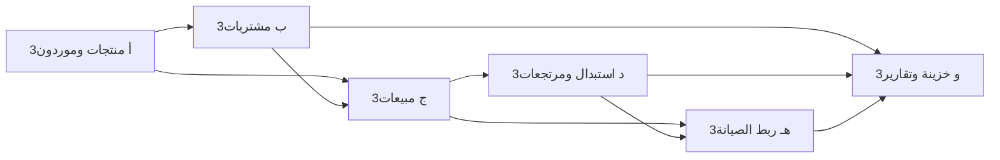

# المرحلة 3: المبيعات والمشتريات والموردون (قطاع السماعات فقط)

**الهدف:** إضافة دورة بيع وشراء كاملة مرتبطة بالمخزون والخزينة. الوحدات `sales` و`purchases` و`suppliers` تُفعَّل فقط في ملف `hearing_aids`.

## المراحل الفرعية

تُنفَّذ بالترتيب، وكل مرحلة فرعية تنتهي ببناء ناجح واختبار يدوي وcommit مستقل قبل التالية.

| # | المرحلة الفرعية | البنود | تعتمد على |
|---|-----------------|--------|-----------|
| 3أ | المنتجات والموردون | 3.1، 3.2 | المرحلتان 1، 2 |
| 3ب | المشتريات | 3.3 | 3أ |
| 3ج | المبيعات والبيع السريع | 3.4 | 3أ (ويُفضّل بعد 3ب لتوفر مخزون) |
| 3د | المرتجعات والاستبدال | 3.4.1 | 3ج |
| 3هـ | الربط بالصيانة (خارجية وبديلة) | 3.5 | 3ج، 3د |
| 3و | الخزينة والتقارير | 3.6 | 3ب-3هـ |

### معيار قبول كل مرحلة فرعية
- **3أ:** إنشاء منتج بتنوعات (مقاسات بطاريات) وسماعة وقوقعة بأرقام تسلسلية، وإدارة الموردين، ولا تظهر في `appliances`.
- **3ب:** شراء بنقد/آجل/جزئي يزيد المخزون والأرقام التسلسلية ويحدّث رصيد المورد والخزينة، وشراء مستعمل من عميل.
- **3ج:** بيع بالرقم التسلسلي وبيع بطارية بالعبوة/القطعة بدون عميل، مع دفعات ورصيد عميل وضمان تلقائي وطباعة.
- **3د:** مرتجع مبيعات/مشتريات واستبدال (عادي/مستعمل/ضمان) بحساب الفرق وتحديث المخزون والخزينة.
- **3هـ:** فتح صيانة من فاتورة، وإرسال خارجي، وسماعة بديلة، وخصم قطع الصيانة من المخزون.
- **3و:** تقارير ولوحة تحكم صحيحة الأرقام.

> البنود تحت «المهام» أدناه موسومة بحرف المرحلة الفرعية.

## المهام

### 3.1 المنتجات (3أ)
- جدول `products(id, name, type, brand, model, sku, barcode, cost_price, sale_price, track_serial, min_stock, qty, warranty_months, extra_data, is_active)`.
- جدول `product_serials(id, product_id, serial_no, status, purchase_item_id, sale_item_id)` للمنتجات ذات الرقم التسلسلي (السماعات). الحالات: `in_stock | sold | returned | defective`.
- ملحقات وبطاريات تبقى بالكمية فقط (`track_serial = 0`).
- ربط الحركات بـ `inventory_movements` الحالي.
- **تنوعات المنتج (variants):** جدول `product_variants(id, product_id, size, color, sku, barcode, qty, min_stock)`؛ تُستخدم لمقاسات البطاريات (10، 312، 13، 675...) وألوان/مقاسات الإكسسوارات. حد أدنى وتنبيه نقص لكل مقاس.
- **وحدات البيع:** عبوة (6 قطع مثلاً) وقطعة منفردة مع تحويل تلقائي بين الوحدتين في المخزون.
- **تصنيف فرعي** للإكسسوارات والقوقعة، وحقل «متوافق مع» (ماركات/موديلات) للإكسسوارات وقطع القوقعة.
- **منتجات القوقعة:** المعالجات بالرقم التسلسلي (`track_serial = 1`)، والملفات والكابلات والمغناطيس والبطاريات بالكمية.
- **خدمات** (`type = service`): قالب، تنظيف، ضبط، برمجة؛ تُباع في الفاتورة بلا مخزون.

### 3.2 الموردون (3أ)
- جدول `suppliers(id, name, phone, address, balance, notes)`.
- شاشة الموردين: قائمة، كشف حساب، سداد دفعات.

### 3.3 المشتريات (3ب)
- جداول `purchase_invoices` و`purchase_items`.
- فاتورة شراء: اختيار المورد والأصناف والكمية والتكلفة، وإدخال الأرقام التسلسلية.
- الدفع نقداً أو آجلاً أو جزئياً، ويُسجل في `treasury_transactions` ويحدّث رصيد المورد.
- مرتجع مشتريات.
- **شراء مستعمل من عميل:** فاتورة شراء بمورد من نوع «عميل»، تدخل السماعة المخزون بحالة `used` ويمكن إعادة بيعها بعد الفحص.

### 3.4 المبيعات (3ج)
- جداول `sales_invoices` و`sales_items` و`sales_payments`.
- فاتورة بيع (POS): اختيار العميل/المريض، الأصناف، اختيار الرقم التسلسلي، الخصم، الدفع.
- أقساط/دفعات متعددة، ورصيد مستحق على العميل.
- مرتجع مبيعات يعيد الصنف للمخزون.
- حساب بداية/نهاية الضمان تلقائياً من تاريخ البيع.
- طباعة الفاتورة وشهادة الضمان في `PrintModal.vue`.
- **بيع سريع (POS) بدون عميل:** للبطاريات والإكسسوارات، بمسح الباركود أو اختيار المقاس، ودفع نقدي فوري.

### 3.4.1 المرتجعات والاستبدال (3د)
- مرتجع المبيعات والمشتريات (المذكوران أعلاه) يُنفَّذان في هذه المرحلة الفرعية.

#### الاستبدال (Exchange)
- **استبدال بيع:** إعادة الصنف القديم (للمخزون أو كمعيب) وبيع صنف جديد في عملية واحدة، مع حساب فرق السعر (يدفعه العميل أو يُرد له) وتسجيله في الخزينة.
- **استبدال سماعة مستعملة (Trade-in):** تقييم سماعة العميل القديمة وخصم قيمتها من الجديدة، وإدخالها المخزون كمستعمل.
- **استبدال ضمان:** سماعة بديلة من المخزون مقابل معيبة داخل الضمان، مع نقل الضمان للرقم التسلسلي الجديد وإرسال المعيبة للشركة (انظر 3.5).
- ربط الاستبدال بالفاتورة الأصلية والرقم التسلسلي، ومنع الاستبدال خارج مدة السياسة المحددة.

### 3.5 الربط بالصيانة (3هـ)
- فتح طلب صيانة من فاتورة بيع أو رقم تسلسلي.
- التحقق من الضمان تلقائياً (داخل/خارج الضمان) وتعبئة بيانات السماعة.
- **صيانة خارجية:** حالات إضافية للطلب: `أُرسلت للشركة/المعمل`، `عادت`؛ مع تسجيل الجهة وتاريخ الإرسال والاستلام وتكلفتها وتتبع المتأخر.
- **سماعة بديلة (Loaner):** إعارة سماعة من المخزون للعميل أثناء الصيانة وتسجيلها وإرجاعها.
- استهلاك قطع الغيار والبطاريات والإكسسوارات من المخزون داخل طلب الصيانة، وإضافتها لتكلفة الطلب.

### 3.6 الخزينة والتقارير (3و)
- ربط المبيعات والمشتريات بالخزينة (واردات/مصروفات).
- تقارير: مبيعات يومية/شهرية، أرباح (سعر بيع − تكلفة)، مخزون، حساب الموردين، ديون العملاء.
- لوحة التحكم: مؤشرات المبيعات والمخزون المنخفض.

## الملفات المتأثرة
`db.ts`، `types.ts`، `preload`، `lanServer.ts`، `webApiBridge.ts`، `InventoryView.vue`، `TreasuryView.vue`، `ReportsView.vue`، `DashboardView.vue`، وشاشات جديدة: `SalesView.vue`، `PurchasesView.vue`، `SuppliersView.vue`، `ProductsView.vue`.

## معيار القبول
- [ ] لا تظهر هذه الشاشات في قطاع `appliances`.
- [ ] شراء سماعة بالرقم التسلسلي ثم بيعها يغيّر حالتها ويحدّث المخزون والخزينة.
- [ ] لا يمكن بيع رقم تسلسلي مباع مسبقاً.
- [ ] أرصدة العملاء والموردين صحيحة بعد الدفعات والمرتجعات.
- [ ] فتح صيانة من فاتورة يحدد حالة الضمان صحيحاً.
- [ ] بيع بطارية مقاس 312 بالعبوة والقطعة يخصم صحيحاً وينبه عند نقص المقاس.
- [ ] الاستبدال (عادي/مستعمل/ضمان) يحسب الفرق ويحدّث المخزون والخزينة والضمان.
- [ ] إرسال سماعة للصيانة الخارجية وإعارة بديلة وإرجاعها يُسجلان صحيحاً.
- [ ] العمليات تتم داخل transactions في SQLite لضمان الاتساق.

## المخاطر
- الدقة المحاسبية: استخدم أعداداً صحيحة (قروش) أو تقريباً موحداً.
- حجم المرحلة كبير: نُفِّذ التقسيم إلى المراحل الفرعية 3أ-3و أعلاه؛ لا تبدأ مرحلة فرعية قبل اجتياز معيار قبول سابقتها.

