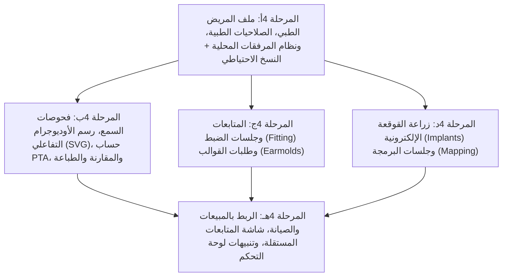

# خطة تنفيذ المرحلة 4 (تفصيلية): ملف المريض وفحوصات السمع والمتابعة والقوالب والقوقعة (قطاع السماعات فقط)

مبنية على مراجعة الكود الفعلي بعد إتمام المراحل 1 و2 و3 (3أ–3و). هذه الخطة تفصّل [04-phase-patient-audiology.md](04-phase-patient-audiology.md) وتقسّم العمل إلى المراحل الفرعية الخمس (**4أ ← 4هـ**) مع تحديد الجداول، الأنواع، قنوات الـ IPC، الصلاحيات، الشاشات، ومعايير القبول لكل مرحلة فرعية.

---

## 0. اكتشافات من الكود الفعلي تُوجّه التصميم والتنفيذ

| # | الاكتشاف في الكود الحالي | الأثر على التصميم والتنفيذ |
|---|--------------------------|----------------------------|
| 1 | جدول `customers` في [db.ts](../src/main/db.ts#L419-L428) يعتمد عليه كل من `maintenance_tickets` و`sales_invoices` و`purchase_invoices` و`customer_appliances` عبر `customer_id`. | بدلاً من فصل جدول `patients` وكسر العلاقات الحالية، نُوسّع جدول `customers` عبر `ensureColumn` في `runMigrations()` بإضافة الحقول الطبية (`birth_date`, `gender`, `occupation`, `medical_complaint`, `medical_history`, `allergies`, `doctor_notes`, `referring_doctor`)، بحيث يبقى `patient_id === customer.id` متوافقاً 100% مع فواتير المبيعات وطلبات الصيانة والأجهزة، مع إخفاء الحقول والتبويبات الطبية تماماً في قطاع `appliances`. |
| 2 | نافذة سجل العميل في [CustomersView.vue](../src/renderer/src/views/CustomersView.vue#L550-L859) تعرض حالياً قسمين فقط (الأجهزة المسجلة + طلبات الصيانة). | في قطاع `hearing_aids`، تتحول نافذة ملف المريض في `CustomersView.vue` إلى **ملف طبي متكامل ذي 6 تبويبات**: (`1. البيانات والسجل الطبي`، `2. فحوصات السمع والأوديوجرام`، `3. السماعات والقواقع والقوالب`، `4. الفواتير والصيانة`، `5. المتابعات وجلسات الضبط`، `6. المرفقات الطبية`)، بينما يظل العرض الحالي في قطاع `appliances` كما هو دون أي تغيير. |
| 3 | نظام الصلاحيات في [channelPolicy.ts](../src/main/channelPolicy.ts) و[appStore.ts](../src/renderer/src/stores/appStore.ts) يدعم `public`, `authenticated`, `manager`, `financial`, `inventory`, `super_admin`. | البيانات الطبية حساسة؛ نُضيف مستوى صلاحية جديد `'medical'` في `channelPolicy.ts` وخاصية `canViewMedicalRecords` في `appStore.ts` (تُمنح لـ `super_admin`, `owner`, `tenant`, `receptionist`، وتُحجب عن `storekeeper` و`cashier` غير المختصين طبياً)، فلا يستطيع أمين المخزن أو الكاشير استعراض أو تعديل الفحوصات السمعية أو التاريخ المرضي أو جلسات برمجة القوقعة. |
| 4 | النسخ الاحتياطي في [db.ts](../src/main/db.ts#L3226-L3299) ينسخ ملف `sallehli_aljoker.sqlite` فقط. | المرفقات الطبية (صور تقارير خارجية، ملفات Map للقوقعة، صور أوديوجرام) تُحفظ كملفات فعلية في مجلد محلي بجوار قاعدة البيانات `join(app.getPath('userData'), 'patient_attachments')` لعدم تضخيم حجم ملف SQLite، مع فهرستها في جدول `patient_attachments`، وتحديث دوال النسخ الاحتياطي والاستعادة (`createBackupToFile`, `restoreBackupFromFile`, `runAutoBackup`) لنسخ واستعادة مجلد المرفقات جنباً إلى جنب مع قاعدة البيانات. |
| 5 | عند بيع سماعة أو معالج قوقعة في المرحلة 3 (`saveSalesInvoice`)، يتم تلقائياً تحديث `product_serials` وإنشاء سجل في `customer_appliances`. | في المرحلة 4، عند تسجيل زراعة قوقعة (`implants`) أو طلب قالب (`earmold_orders`) أو جلسة متابعة (`followups`)، نربطها مباشرة بـ `customer_appliances` و`product_serials` الخاصة بالمريض لتوحيد دورة حياة السماعة/المعالج والضمان والملحقات. |
| 6 | الدالة `isBusinessDataEmpty()` في [db.ts](../src/main/db.ts#L3313-L3351) تفحص الجداول قبل السماح بتبديل النشاط بدون كلمة مرور. | نُضيف الجداول الطبية الجديدة (`hearing_tests`, `followups`, `earmold_orders`, `implants`, `patient_attachments`) إلى قائمة الفحص في `isBusinessDataEmpty()`. |
| 7 | `PrintModal.vue` يدعم حالياً طباعة تذاكر الصيانة وفواتير المبيعات. | نُوسّع `PrintModal.vue` و`appStore.ts` لدعم طباعة **تقرير فحص السمع الرسمي (Audiogram Report A4)** متضمناً مخطط الأوديوجرام الملون للأذنين وجدول نتائج الكلام (SRT / SDS) والطبلة (Tympanometry) ودرجة الفقد والتوصية الطبية، بالإضافة إلى **إيصال طلب قالب أذن (Earmold Order)**. |

---

## 1. خارطة المراحل الفرعية وترتيب التنفيذ

تُنفَّذ المراحل الفرعية بالترتيب، وكل مرحلة فرعية تنتهي ببناء ناجح (`npm run build`) واختبار يدوي لمعايير قبولها قبل الانتقال للتالية:



### تفعيل الوحدات والصلاحيات في `businessProfiles.ts` و`channelPolicy.ts`
- تُضاف الوحدة `'followups'` (المتابعات والقوالب السمعية) إلى مصفوفة `modules` في `HEARING_AIDS_PROFILE` فقط داخل [src/shared/businessProfiles.ts](../src/shared/businessProfiles.ts).
- تبقى مصفوفة `APPLIANCES_PROFILE.modules` كما هي تماماً.
- **الصلاحيات الطبية (`medical` في `channelPolicy.ts`):**
  - الأدوار المصرح لها بالوصول للسجلات الطبية والفحوصات (`isRoleAuthorized(role, 'medical')`):
    `super_admin`، `owner`، `tenant`، `receptionist`.
  - الأدوار غير الطبية (`storekeeper` أمين المخزن، و`cashier` الكاشير فقط): يرون البيانات الأساسية للعميل (الاسم، الهاتف، العنوان، الفواتير) لإتمام عمليات الصرف والتحصيل، دون رؤية أو تعديل السجل الطبي أو فحوصات السمع أو جلسات القوقعة.

---

## 2. المرحلة الفرعية 4أ: ملف المريض الطبي، المرفقات المحلية، والصلاحيات

### 2.1 قاعدة البيانات (`src/main/db.ts`)

1. **توسيع جدول `customers` في `runMigrations()` (عبر `ensureColumn`):**
   - `birth_date TEXT DEFAULT NULL` (تاريخ الميلاد — يُحسب منه العمر تلقائياً في الواجهة)
   - `gender TEXT DEFAULT ''` (`'male' | 'female' | ''`)
   - `occupation TEXT DEFAULT ''` (المهنة / طبيعة بيئة العمل الصوتية)
   - `referring_doctor TEXT DEFAULT ''` (الطبيب أو المستشفى المُحيل)
   - `medical_complaint TEXT DEFAULT ''` (الشكوى السمعية الرئيسية، مثل: طنين، ضعف سمع تدريجي، صعوبة تمييز الكلام في الضوضاء)
   - `medical_history TEXT DEFAULT ''` (التاريخ المرضي/العائلي، التهابات الأذن الوسطى، عمليات سابقة، أمراض مزمنة)
   - `allergies TEXT DEFAULT ''` (الحساسية الجلدية أو الدوائية — مهمة جداً عند اختيار مادة القالب `Biopor / Silicone`)
   - `doctor_notes TEXT DEFAULT ''` (ملاحظات الطبيب أو أخصائي السمعيات)

2. **جدول المرفقات الطبية `patient_attachments`:**
   ```sql
   CREATE TABLE IF NOT EXISTS patient_attachments (
     id INTEGER PRIMARY KEY AUTOINCREMENT,
     patient_id INTEGER NOT NULL,
     entity_type TEXT NOT NULL DEFAULT 'patient'
       CHECK(entity_type IN ('patient', 'hearing_test', 'implant_session', 'earmold', 'followup')),
     entity_id INTEGER DEFAULT NULL,
     title TEXT NOT NULL,
     category TEXT NOT NULL DEFAULT 'general'
       CHECK(category IN ('external_report', 'audiogram_scan', 'mapping_file', 'prescription', 'id_card', 'general')),
     file_name TEXT NOT NULL,
     stored_name TEXT NOT NULL UNIQUE,
     mime_type TEXT NOT NULL DEFAULT 'application/octet-stream',
     file_size INTEGER NOT NULL DEFAULT 0,
     notes TEXT DEFAULT '',
     created_at TEXT NOT NULL DEFAULT (datetime('now', 'localtime')),
     FOREIGN KEY (patient_id) REFERENCES customers(id) ON DELETE CASCADE
   );
   ```

3. **إدارة ملفات المرفقات على القرص والنسخ الاحتياطي (`src/main/db.ts`):**
   - دالة `getPatientAttachmentsDir()`: تنشئ وتعيد المسار `join(app.getPath('userData'), 'patient_attachments')`.
   - عند رفع مرفق (`savePatientAttachment`): يُحفظ الملف الفعلي في `patient_attachments/<stored_name>` (سواء عبر اختيار ملف من جهاز الكمبيوتر عبر `dialog.showOpenDialog` أو عبر رفع Base64/Buffer من المتصفح في الشبكة المحلية LAN)، وتُحفظ بياناته الوصفية في جدول `patient_attachments`.
   - دالة `openOrReadPatientAttachment(id)`: تعيد `dataUrl` (للصور وملفات PDF للمعاينة المباشرة) أو تفتح الملف بتطبيق النظام الافتراضي عبر `shell.openPath` (لملفات الـ Map الخاصة بشركات القوقعة مثل `.cdx` / `.msw`).
   - **تحديث النسخ الاحتياطي والاستعادة (`createBackupToFile`, `restoreBackupFromFile`, `runAutoBackup`):**
     - عند إنشاء نسخة احتياطية `X.sqlite`، يتم نسخ مجلد `patient_attachments` إلى مجلد مرافق `X.sqlite.attachments` (أو داخل مجلد النسخ الاحتياطية).
     - عند استعادة نسخة احتياطية `restoreBackupFromFile`، إذا وُجد مجلد المرفقات المرافق يتم استعادته تلقائياً إلى `patient_attachments` لضمان عدم فقدان أي مرفق طبي.

### 2.2 الواجهات في `CustomersView.vue` (4أ)
- في قطاع `hearing_aids`:
  - إضافة الحقول الطبية (تاريخ الميلاد مع عرض العمر بالسنوات، الجنس، المهنة، الطبيب المُحيل، الشكوى السمعية، التاريخ المرضي، الحساسية، ملاحظات الأخصائي) داخل نموذج إضافة/تعديل المريض (للمصرح لهم بصلاحية `canViewMedicalRecords`).
  - تحويل نافذة تفاصيل المريض (`historyModalOpen`) في قطاع `hearing_aids` إلى **نافذة ملف المريض الشامل** بعرض `max-w-6xl` وتبويبات علوية واضحة:
    1. **البيانات والسجل الطبي** (مع تنبيه بارز باللون الأحمر إذا كان للمريض `allergies` حساسية مسجلة).
    2. **فحوصات السمع والأوديوجرام** (تُستكمل في 4ب).
    3. **السماعات والقواقع والقوالب** (الأجهزة المسجلة + القوالب في 4ج + القوقعة في 4د).
    4. **الفواتير والصيانة** (فواتير مبيعات المريض + طلبات الصيانة والضمان).
    5. **المتابعات وجلسات الضبط** (تُستكمل في 4ج).
    6. **المرفقات الطبية** (رفع واستعراض وفتح وحذف التقارير الخارجية وصور الأوديوجرام وملفات البرمجة).

### 2.3 معيار قبول المرحلة الفرعية 4أ
- [x] حفظ وتعديل البيانات الطبية للمريض (تاريخ الميلاد، الحساسية، التاريخ المرضي...) وظهور تنبيه الحساسية في ملفه.
- [x] عدم ظهور أي حقول أو تبويبات طبية في قطاع `appliances`.
- [x] إخفاء التبويبات والحقول الطبية عن المستخدمين غير المصرح لهم طبياً (مثل `storekeeper` و`cashier`).
- [x] رفع مرفق طبي (صورة/ملف) وحفظه بجوار قاعدة البيانات، والتحقق من شموله عند أخذ نسخة احتياطية واستعادتها.

---

## 3. المرحلة الفرعية 4ب: فحوصات السمع ومكوّن الأوديوجرام (SVG) والمقارنة والطباعة

### 3.1 قاعدة البيانات (`src/main/db.ts`)

1. **جدول فحوصات السمع `hearing_tests`:**
   ```sql
   CREATE TABLE IF NOT EXISTS hearing_tests (
     id INTEGER PRIMARY KEY AUTOINCREMENT,
     test_number TEXT NOT NULL UNIQUE,
     patient_id INTEGER NOT NULL,
     test_date TEXT NOT NULL DEFAULT (date('now', 'localtime')),
     examiner_id INTEGER DEFAULT NULL,
     examiner_name TEXT DEFAULT '',
     test_type TEXT NOT NULL DEFAULT 'pure_tone'
       CHECK(test_type IN ('pure_tone', 'speech', 'tympanometry', 'comprehensive', 'aided', 'free_field')),
     -- نتائج قياس الكلام (Speech Audiometry)
     srt_right REAL DEFAULT NULL, -- Speech Reception Threshold (dB)
     srt_left REAL DEFAULT NULL,
     sds_right REAL DEFAULT NULL, -- Speech Discrimination Score (%)
     sds_left REAL DEFAULT NULL,
     mcl_right REAL DEFAULT NULL, -- Most Comfortable Level (dB)
     mcl_left REAL DEFAULT NULL,
     ucl_right REAL DEFAULT NULL, -- Uncomfortable Loudness Level (dB)
     ucl_left REAL DEFAULT NULL,
     -- تقييم الطبلة والأذن الوسطى (Tympanometry)
     tymp_right TEXT DEFAULT '', -- 'Type A' | 'Type As' | 'Type Ad' | 'Type B' | 'Type C'
     tymp_left TEXT DEFAULT '',
     -- متوسط الفقد السمعي والتشخيص (PTA & Classification)
     pta_right REAL DEFAULT NULL, -- متوسط (500, 1000, 2000, 4000 Hz)
     pta_left REAL DEFAULT NULL,
     loss_type_right TEXT DEFAULT '', -- طبيعي | توصيلي | حسي عصبي | مختلط
     loss_type_left TEXT DEFAULT '',
     loss_degree_right TEXT DEFAULT '', -- طبيعي | خفيف | متوسط | متوسط الشدة | شديد | عميق
     loss_degree_left TEXT DEFAULT '',
     -- التوصية والربط بالمبيعات
     recommended_product_id INTEGER DEFAULT NULL,
     recommended_product_name TEXT DEFAULT '',
     recommendation_notes TEXT DEFAULT '',
     notes TEXT DEFAULT '',
     created_at TEXT NOT NULL DEFAULT (datetime('now', 'localtime')),
     FOREIGN KEY (patient_id) REFERENCES customers(id) ON DELETE CASCADE,
     FOREIGN KEY (examiner_id) REFERENCES technicians(id) ON DELETE SET NULL,
     FOREIGN KEY (recommended_product_id) REFERENCES products(id) ON DELETE SET NULL
   );
   ```

2. **جدول نقاط الأوديوجرام `audiogram_points`:**
   ```sql
   CREATE TABLE IF NOT EXISTS audiogram_points (
     id INTEGER PRIMARY KEY AUTOINCREMENT,
     test_id INTEGER NOT NULL,
     ear TEXT NOT NULL CHECK(ear IN ('right', 'left')),
     conduction TEXT NOT NULL CHECK(conduction IN ('air', 'bone')),
     frequency INTEGER NOT NULL CHECK(frequency IN (250, 500, 1000, 2000, 4000, 8000)),
     db_value REAL NOT NULL CHECK(db_value >= -10 AND db_value <= 120),
     is_masked INTEGER NOT NULL DEFAULT 0,
     no_response INTEGER NOT NULL DEFAULT 0, -- في حال عدم الاستجابة عند أقصى شدة (NR)
     UNIQUE(test_id, ear, conduction, frequency),
     FOREIGN KEY (test_id) REFERENCES hearing_tests(id) ON DELETE CASCADE
   );
   ```

### 3.2 الحسابات السمعية التلقائية (PTA، درجة الفقد، ونوع الفقد)
تُنفذ في دالة مساعدة مشتركة (قابلة للاستدعاء الفوري في الواجهة أثناء الإدخال وفي `db.ts`):
1. **حساب متوسط النغمات النقية (PTA - Pure Tone Average):**
   - لكل أذن على حدة، يُحسب متوسط قيم `db_value` للتوصيل الهوائي (`conduction = 'air'`) عند الترددات الأربعة القياسية: `500, 1000, 2000, 4000 Hz` (أو المتوفر منها إن كان عددها ≥ 3).
2. **اقتراح درجة الفقد السمعي (`loss_degree`) بناءً على PTA (معيار WHO / ASHA):**
   - `PTA <= 25 dB`: `طبيعي (Normal)`
   - `26 – 40 dB`: `فقد سمعي خفيف (Mild)`
   - `41 – 55 dB`: `فقد سمعي متوسط (Moderate)`
   - `56 – 70 dB`: `فقد سمعي متوسط الشدة (Moderately Severe)`
   - `71 – 90 dB`: `فقد سمعي شديد (Severe)`
   - `> 90 dB`: `فقد سمعي عميق (Profound)`
3. **اقتراح نوع الفقد السمعي (`loss_type`) بناءً على الفجوة الهوائية-العظمية (Air-Bone Gap):**
   - إذا كان `PTA الهوائي <= 25 dB`: `سمع طبيعي (Normal)`
   - إذا وُجدت نقاط توصيل عظمي (`bone`):
     - `PTA العظمي <= 25 dB` والفجوة `(Air PTA - Bone PTA) >= 15 dB`: `توصيلي (Conductive)`
     - `PTA العظمي > 25 dB` والفجوة `< 15 dB`: `حسي عصبي (Sensorineural)`
     - `PTA العظمي > 25 dB` والفجوة `>= 15 dB`: `مختلط (Mixed)`
   - يظهر الاقتراح فوراً في النموذج مع إمكانية تعديله يدوياً من قِبل الأخصائي.

### 3.3 المكونات الجديدة لفحوصات السمع (4ب)
1. **مكوّن رسم الأوديوجرام التفاعلي `src/renderer/src/components/AudiogramChart.vue`:**
   - مرسوم بـ **SVG نقي وعالي الدقة** (يعمل في العرض العادي والوضع الليلي والطباعة الرسمية بدون مكتبات خارجية ثقيلة).
   - المحور الأفقي (X): الترددات `250, 500, 1000, 2000, 4000, 8000 Hz`.
   - المحور الرأسي (Y): مستوى شدة الصوت من `-10 dB` في الأعلى إلى `120 dB` في الأسفل بخطوة `10 dB` (مع مناطق لونية اختيارية خفيفة لدرجات الفقد من الطبيعي حتى العميق).
   - **الإدخال التفاعلي بالنقر:**
     - اختيار وضع الإدخال النشط من شريط أدوات علوي: الأذن (`يمين R أحمر` / `يسار L أزرق`)، التوصيل (`هوائي Air` / `عظمي Bone`)، وخيار `Masking (تغطية)` أو `حذف نقطة`.
     - النقر على تقاطع التردد ومستوى الـ dB (أقرب `5 dB`) يضيف أو يحدّث النقطة فوراً.
   - **الرموز القياسية العالمية (ANSI / ISO Audiogram Symbols):**
     - **الأذن اليمنى (أحمر `#dc2626`):**
       - هوائي بدون ماسك: دائرة حمراء `O` متصلة بخط أحمر متصل.
       - هوائي مع ماسك: مثلث أحمر `△` متصل بخط أحمر متصل.
       - عظمي بدون ماسك: علامة `<` حمراء متصلة بخط أحمر متقطع.
       - عظمي مع ماسك: علامة `[` حمراء متصلة بخط أحمر متقطع.
     - **الأذن اليسرى (أزرق `#2563eb`):**
       - هوائي بدون ماسك: علامة `X` زرقاء متصلة بخط أزرق متصل.
       - هوائي مع ماسك: مربع أزرق `□` متصل بخط أزرق متصل.
       - عظمي بدون ماسك: علامة `>` زرقاء متصلة بخط أزرق متقطع.
       - عظمي مع ماسك: علامة `]` زرقاء متصلة بخط أزرق متقطع.
   - **وضع العرض:** إمكانية عرض الأذنين في **مخطط مدمج واحد** أو **مخططين منفصلين جنباً إلى جنب (يمين R | يسار L)** (وهو المفضل في تقارير الطباعة الطبية).
   - **وضع المقارنة بين فحصين (`comparisonPoints`):** يرسم منحنى الفحص السابق بخطوط رمادية/منقطة مع توضيح الفروق، ليرى الطبيب والمريض تطور السمع بين الفحصين بصرياً ورقمياً.

2. **مكوّن نموذج وإدارة فحص السمع `src/renderer/src/components/HearingTestForm.vue`:**
   - يجمع بين:
     - الرسم التفاعلي `AudiogramChart.vue`.
     - **الجدول الرقمي السريع** أسفل أو بجانب الرسم (إدخال مباشر بالأرقام وزر تفعيل الـ Masking لكل تردد `250..8000 Hz` للهوائي والعظمي، متزامن ثنائياً مع الرسم).
     - حقول نتائج الكلام (`SRT dB`, `SDS %`, `MCL`, `UCL`) وتقييم الطبلة (`Tympanometry: Type A, As, Ad, B, C`).
     - بطاقة التشخيص التلقائي (`PTA`، نوع الفقد، درجة الفقد للأذنين) مع زر «تطبيق الاقتراح التلقائي».
     - قسم **التوصية الطبية:** اختيار السماعة/الموديل الموصى به من جدول `products` وملاحظات التوصية، مع زر مباشر **«تحويل التوصية إلى فاتورة بيع»**.

3. **طباعة تقرير فحص السمع في `PrintModal.vue`:**
   - إضافة نوع مستند طباعة جديد `activePrintDocType = 'hearing_test'` مع `hearingTestToPrint` في `appStore.ts`.
   - قالب A4 طبي احترافي يحتوي على ترويسة المركز، بيانات المريض وعمره وتاريخ الفحص واسم الأخصائي، مخططَي الأوديوجرام (الأذن اليمنى والأذن اليسرى) بـ SVG واضح للطباعة، جدول الترددات، جدول قياس الكلام والطبلة، التشخيص الطبي، والسماعة الموصى بها وتوقيع الأخصائي.

### 3.4 معيار قبول المرحلة الفرعية 4ب
- [x] إدخال فحص سمعي كامل بالنقر على مخطط الأوديوجرام أو من الجدول الرقمي ورؤية الرموز القياسية (`O` أحمر لليمين، `X` أزرق لليسار، والهوائي والعظمي والـ Masking).
- [x] حساب متوسط `PTA` واقتراح درجة ونوع الفقد السمعي تلقائياً للأذنين مع قابلية التعديل.
- [x] مقارنة فحصين لنفس المريض على الرسم وفي جدول المقارنة.
- [x] طباعة تقرير الفحص السمعي الرسمي مع رسم الأوديوجرام في `PrintModal.vue`.

---

## 4. المرحلة الفرعية 4ج: المتابعة والضبط (Fitting) وطلبات القوالب (Earmolds)

### 4.1 قاعدة البيانات (`src/main/db.ts`)

1. **جدول المتابعات وجلسات الضبط `followups`:**
   ```sql
   CREATE TABLE IF NOT EXISTS followups (
     id INTEGER PRIMARY KEY AUTOINCREMENT,
     patient_id INTEGER NOT NULL,
     device_id INTEGER DEFAULT NULL, -- يشير إلى customer_appliances.id
     serial_no TEXT DEFAULT '',
     implant_id INTEGER DEFAULT NULL,
     type TEXT NOT NULL DEFAULT 'fitting'
       CHECK(type IN ('fitting', 'cleaning', 'battery_mold', 'periodic_check', 'rehab', 'mapping')),
     status TEXT NOT NULL DEFAULT 'pending'
       CHECK(status IN ('pending', 'completed', 'cancelled')),
     due_date TEXT NOT NULL,
     done_date TEXT DEFAULT NULL,
     technician_id INTEGER DEFAULT NULL,
     fitting_settings_json TEXT NOT NULL DEFAULT '{}', -- البرنامج، مستوى الصوت، Gain، الـ Feedback، برنامج الضوضاء/التليفون
     notes TEXT DEFAULT '',
     created_at TEXT NOT NULL DEFAULT (datetime('now', 'localtime')),
     FOREIGN KEY (patient_id) REFERENCES customers(id) ON DELETE CASCADE,
     FOREIGN KEY (device_id) REFERENCES customer_appliances(id) ON DELETE SET NULL,
     FOREIGN KEY (technician_id) REFERENCES technicians(id) ON DELETE SET NULL
   );
   ```

2. **جدول طلبات القوالب `earmold_orders` (4.3.1):**
   ```sql
   CREATE TABLE IF NOT EXISTS earmold_orders (
     id INTEGER PRIMARY KEY AUTOINCREMENT,
     order_number TEXT NOT NULL UNIQUE,
     patient_id INTEGER NOT NULL,
     device_id INTEGER DEFAULT NULL,
     sales_invoice_id INTEGER DEFAULT NULL,
     ear TEXT NOT NULL DEFAULT 'right' CHECK(ear IN ('right', 'left', 'bilateral')),
     mold_type TEXT NOT NULL DEFAULT '', -- من lookup_items (earmold_type)
     material TEXT NOT NULL DEFAULT '', -- من lookup_items (earmold_material)
     color TEXT DEFAULT 'شفاف',
     vent_size TEXT DEFAULT 'بدون تهوية (No Vent)', -- مثلاً: 1mm, 2mm, Select-A-Vent, IROS
     tube_type TEXT DEFAULT 'عادي (Standard #13)',
     impression_date TEXT NOT NULL DEFAULT (date('now', 'localtime')),
     lab_name TEXT NOT NULL DEFAULT '',
     sent_date TEXT DEFAULT NULL,
     expected_date TEXT DEFAULT NULL,
     received_date TEXT DEFAULT NULL,
     delivered_date TEXT DEFAULT NULL,
     status TEXT NOT NULL DEFAULT 'impression_taken'
       CHECK(status IN ('impression_taken', 'sent_to_lab', 'received', 'delivered', 'remake')),
     lab_cost REAL NOT NULL DEFAULT 0,
     customer_price REAL NOT NULL DEFAULT 0,
     is_lab_cost_paid INTEGER NOT NULL DEFAULT 0,
     remake_of_id INTEGER DEFAULT NULL, -- رابط للطلب الأصلي في حال إعادة التصنيع
     notes TEXT DEFAULT '',
     created_at TEXT NOT NULL DEFAULT (datetime('now', 'localtime')),
     FOREIGN KEY (patient_id) REFERENCES customers(id) ON DELETE CASCADE,
     FOREIGN KEY (device_id) REFERENCES customer_appliances(id) ON DELETE SET NULL,
     FOREIGN KEY (sales_invoice_id) REFERENCES sales_invoices(id) ON DELETE SET NULL,
     FOREIGN KEY (remake_of_id) REFERENCES earmold_orders(id) ON DELETE SET NULL
   );
   ```

### 4.2 منطق المتابعات والقوالب (`db.ts`)
1. **جلسات الضبط (Fitting) والمتابعة:**
   - حفظ إعدادات البرمجة في `fitting_settings_json`: (`software`: برنامج الشركة مثل Phonak Target / Oticon Genie، `program_modes`: البرامج المفعلة كالهدوء/الضوضاء/الموسيقى/الملف المغناطيسي T-Coil، `gain_level`: نسبة التأقلم 70% / 80% / 100%، `volume_control`: مفعّل/معطّل، `patient_feedback`: ملاحظات استجابة المريض).
   - عند إتمام جلسة ضبط، يقترح النظام جدولة المتابعة القادمة بضغطة واحدة (مثلاً بعد أسبوعين أو 3 أشهر أو 6 أشهر).
2. **دورة حياة طلب القالب (`earmold_orders`):**
   - الحالات المتسلسلة:
     1. `impression_taken`: «أخذ مقاس الأذن (Impression)»
     2. `sent_to_lab`: «أُرسل للمعمل» (يُسجل `sent_date` و`expected_date`)
     3. `received`: «وصل من المعمل (جاهز للتسليم)» (يُسجل `received_date` ويُفعّل تذكير تسليم للمريض)
     4. `delivered`: «سُلّم للمريض» (يُسجل `delivered_date`)
     5. `remake`: «إعادة تصنيع (Remake)»
   - **زر «إعادة تصنيع (Remake)»:** يحوّل حالة الطلب الحالي إلى `remake`، وينشئ تلقائياً طلب قالب جديد ينسخ مواصفات المريض والأذن ونوع القالب والمادة مع ربطه بـ `remake_of_id = originalOrder.id` وتصفير السعر على المريض إذا كان داخل ضمان المقاس.
   - **الربط المالي لطلب القالب:**
     - خيار إنشاء فاتورة بيع تلقائية (أو ربطه بفاتورة بيع قائمة `sales_invoice_id`) بقيمة `customer_price`.
     - خيار تسجيل تكلفة المعمل `lab_cost` كمصروف في الخزينة (`treasury_transactions` تحت فئة `'مصروفات معمل قوالب'`).

### 4.3 معيار قبول المرحلة الفرعية 4ج
- [x] تسجيل موعد متابعة وجلسة ضبط (Fitting) بإعداداتها التفصيلية وتحويلها إلى مكتملة مع جدولة الموعد القادم.
- [x] إنشاء طلب قالب أذن وتمريره عبر الحالات الخمس (`أخذ مقاس ← أُرسل للمعمل ← وصل ← سُلّم ← إعادة تصنيع`) مع حفظ رابط الطلب الأصلي عند إعادة التصنيع.
- [x] ربط طلب القالب بفاتورة بيع وبتكلفة المعمل، وظهور الطلبات المتأخرة عن المعمل والطلبات التي وصلت وبانتظار التسليم.

---

## 5. المرحلة الفرعية 4د: زراعة القوقعة الإلكترونية (Cochlear Implants) وجلسات البرمجة (Mapping)

### 5.1 قاعدة البيانات (`src/main/db.ts`)

1. **جدول زراعة القوقعة `implants`:**
   ```sql
   CREATE TABLE IF NOT EXISTS implants (
     id INTEGER PRIMARY KEY AUTOINCREMENT,
     patient_id INTEGER NOT NULL,
     ear TEXT NOT NULL CHECK(ear IN ('right', 'left')),
     brand TEXT NOT NULL, -- Cochlear | MED-EL | Advanced Bionics
     internal_model TEXT NOT NULL DEFAULT '', -- موديل الجزء الداخلي المزروع (مثلاً CI622 / Synchrony 2)
     internal_serial TEXT NOT NULL DEFAULT '', -- الرقم التسلسلي للجزء الداخلي
     surgery_date TEXT DEFAULT NULL,
     hospital TEXT DEFAULT '',
     surgeon TEXT DEFAULT '',
     activation_date TEXT DEFAULT NULL, -- تاريخ التفعيل الأول (Switch-on)
     processor_device_id INTEGER DEFAULT NULL, -- يشير إلى customer_appliances.id
     processor_serial_id INTEGER DEFAULT NULL, -- يشير إلى product_serials.id
     processor_model TEXT DEFAULT '', -- مثلاً Nucleus 8 / Sonnet 2
     processor_serial_no TEXT DEFAULT '',
     processor_warranty_end TEXT DEFAULT NULL,
     accessories_json TEXT NOT NULL DEFAULT '{}', -- تفاصيل الملحقات: قوة المغناطيس، طول كابل الملف، نوع الملف، البطاريات، المجفف
     notes TEXT DEFAULT '',
     created_at TEXT NOT NULL DEFAULT (datetime('now', 'localtime')),
     FOREIGN KEY (patient_id) REFERENCES customers(id) ON DELETE CASCADE,
     FOREIGN KEY (processor_device_id) REFERENCES customer_appliances(id) ON DELETE SET NULL,
     FOREIGN KEY (processor_serial_id) REFERENCES product_serials(id) ON DELETE SET NULL
   );
   ```

2. **جدول جلسات برمجة القوقعة (Mapping Sessions) `implant_sessions`:**
   ```sql
   CREATE TABLE IF NOT EXISTS implant_sessions (
     id INTEGER PRIMARY KEY AUTOINCREMENT,
     implant_id INTEGER NOT NULL,
     patient_id INTEGER NOT NULL,
     session_date TEXT NOT NULL DEFAULT (date('now', 'localtime')),
     session_type TEXT NOT NULL DEFAULT 'mapping'
       CHECK(session_type IN ('switch_on', 'mapping', 'rehab', 'periodic_check', 'troubleshooting')),
     technician_id INTEGER DEFAULT NULL,
     examiner_name TEXT DEFAULT '',
     program_notes TEXT DEFAULT '',
     thresholds_json TEXT NOT NULL DEFAULT '{}', -- قيم T-Levels و C-Levels / M-Levels، استراتيجية الترميز (ACE/FS4)، عدد القنوات النشطة، الممانعة (Impedance)
     map_attachment_id INTEGER DEFAULT NULL, -- يشير إلى patient_attachments.id لملف الـ Map المرفق
     next_due_date TEXT DEFAULT NULL,
     followup_id INTEGER DEFAULT NULL, -- تذكير المتابعة المُنشأ تلقائياً
     created_at TEXT NOT NULL DEFAULT (datetime('now', 'localtime')),
     FOREIGN KEY (implant_id) REFERENCES implants(id) ON DELETE CASCADE,
     FOREIGN KEY (patient_id) REFERENCES customers(id) ON DELETE CASCADE,
     FOREIGN KEY (technician_id) REFERENCES technicians(id) ON DELETE SET NULL,
     FOREIGN KEY (map_attachment_id) REFERENCES patient_attachments(id) ON DELETE SET NULL
   );
   ```

### 5.2 منطق القوقعة وجلسات البرمجة (`db.ts` والواجهة)
1. **ربط معالج الصوت والملحقات:**
   - عند تسجيل زراعة قوقعة للمريض، يمكن ربطها بمعالج صوت خارجي تم بيعه للمريض في `product_serials` (أو مسجل في `customer_appliances`)، أو إدخال بيانات المعالج مباشرة فيُزامن النظام سجل `customer_appliances` تلقائياً لتتبع ضمان المعالج.
   - توثيق ملحقات المعالج الدقيقة في `accessories_json`:
     - `magnet_strength`: قوة المغناطيس (`1, 2, 3, 4, 5, 6`) ونوعه (`Standard / Axial / Diametric`).
     - `coil_type`: موديل ملف الإرسال (`Coil`).
     - `cable_length`: طول كابل الملف (`6cm, 8cm, 11cm, 25cm`).
     - `battery_type`: نوع البطاريات القابلة للشحن أو مقاس `675 Implant Plus`.
2. **جلسات البرمجة (Mapping) والتأهيل:**
   - تسجيل بيانات البرمجة (`thresholds_json`): استراتيجية البرمجة (`Coding Strategy`), حالة قياس الممانعة (`Impedance / Telemetry: سليم / قنوات معطلة`)، ملخص مستويات `T-Level` (عتبة السمع) و`C-Level / M-Level` (مستوى الراحة)، والبرنامج المعتمد (`P1, P2, P3, P4`).
   - إمكانية إرفاق ملف الـ Map أو صورة شاشة البرمجة مباشرة في الجلسة (`map_attachment_id`).
   - عند تحديد `next_due_date` (تاريخ الجلسة القادمة للبرمجة أو التأهيل السمعي والنطقي)، يقوم النظام تلقائياً بإنشاء سجل في جدول `followups` بنوع `'mapping'` أو `'rehab'` ليظهر في تنبيهات لوحة التحكم!

### 5.3 معيار قبول المرحلة الفرعية 4د
- [x] تسجيل زراعة قوقعة (الأذن، الماركة، الموديل والسيريال الداخلي، الجراح، المستشفى، وتاريخ التفعيل) وربط معالج الصوت الخارجي وملحقاته (المغناطيس، الملف، الكابل) وتاريخ ضمانه.
- [x] تسجيل جلسة برمجة (Mapping) مع قيم الـ Thresholds وإرفاق ملف/صورة الـ Map.
- [x] توليد تذكير تلقائي بالموعد القادم للبرمجة أو التأهيل السمعي والنطقي.

---

## 6. المرحلة الفرعية 4هـ: شاشة المتابعات والقوالب، والربط بالمبيعات والصيانة ولوحة التحكم

### 6.1 شاشة المتابعات والقوالب السمعية `src/renderer/src/views/FollowupsView.vue`
شاشة تشغيلية يومية مخصصة لقطاع `hearing_aids` (تُضاف في القائمة الجانبية تحت اسم «المتابعات والقوالب السمعية»)، وتضم 3 تبويبات رئيسية:
1. **جدول مواعيد المتابعة والضبط والتأهيل (`followups`):**
   - فلاتر سريعة: «مستحقة اليوم»، «متأخرة (Overdue)»، «القادمة هذا الأسبوع»، «المكتملة»، والفلترة حسب النوع (`ضبط سماعة Fitting`، `برمجة قوقعة Mapping`، `تأهيل سمعي ونطقي`، `تنظيف/بطارية/قالب`، `فحص دوري`).
   - أزرار سريعة لكل موعد: «تسجيل إتمام الجلسة»، «تذكير المريض عبر واتساب برسالة مخصصة»، «فتح ملف المريض».
2. **إدارة ومتابعة طلبات القوالب (`earmold_orders`):**
   - لوحة حالة سريعة (أخذ مقاس | لدى المعمل | متأخر عن المعمل | وصل وبانتظار التسليم | سُلّم | إعادة تصنيع).
   - أزرار تغيير الحالة بضغطة واحدة، طباعة أمر شغل المعمل / إيصال القالب، إرسال رسالة واتساب للمريض («نود إبلاغكم بوصول قالب الأذن الخاص بكم وجاهزيته للتسليم في المركز»)، وزر «إعادة تصنيع (Remake)».
3. **متابعة زارعي القوقعة وجلسات البرمجة القادمة (`implants` & `implant_sessions`):**
   - سجل سريع بزارعي القوقعة ومواعيد جلسات الـ Mapping والتأهيل القادمة وحالة ضمان معالجات الصوت.

### 6.2 الربط مع المبيعات (`SalesView.vue`) والصيانة (`TicketsView.vue`) (4.5)
1. **في شاشة المبيعات `SalesView.vue`:**
   - عند اختيار مريض في تبويب «فاتورة بيع مفصلة»، يقوم النظام بجلب آخر فحص سمعي للمريض (`hearingTests:latestForPatient`) ويعرض شريطاً معلوماتياً ذكياً يوضح:
     - تاريخ آخر فحص، درجة ونوع الفقد لليمين واليسار (`PTA R / L`)، والسماعة الموصى بها من الأخصائي.
     - زر **«إضافة السماعة الموصى بها للفاتورة»** الذي يضيف الصنف الموصى به مباشرة إلى بنود الفاتورة.
   - كما يمكن من داخل نافذة فحص السمع في `CustomersView.vue` الضغط على زر **«إنشاء فاتورة بيع بالتوصية»** الذي ينقل المستخدم إلى `SalesView.vue?patientId=X&recommendedProductId=Y` ويجهز الفاتورة تلقائياً.
2. **في شاشة طلبات الصيانة `TicketsView.vue`:**
   - في قطاع `hearing_aids`، عند اختيار المريض (بالهاتف أو الاسم أو السيريال) داخل نافذة طلب الصيانة:
     - يظهر قسم **«ملخص السجل السمعي وفحوصات المريض»**: يعرض آخر فحوصات السمع المسجلة للمريض (تاريخ الفحص، `PTA` يمين/يسار، درجة الفقد، إعدادات آخر جلسة ضبط Fitting، وتنبيه الحساسية إن وجد) مع زر «معاينة مخطط الأوديوجرام» في نافذة منبثقة سريعة دون مغادرة شاشة الصيانة!

### 6.3 تحديث لوحة التحكم `DashboardView.vue` و`getDashboardStats`
توسيع `DashboardStats` في `types.ts` و`db.ts` و`DashboardView.vue` (لقطاع `hearing_aids` فقط) ليشمل:
- `dueFollowupsTodayCount`: عدد مواعيد المتابعة والضبط المستحقة اليوم.
- `overdueFollowupsCount`: عدد مواعيد المتابعة المتأخرة عن موعدها.
- `overdueEarmoldsCount`: عدد القوالب المتأخرة لدى المعمل (`status = 'sent_to_lab'` وتجاوزت `expected_date`).
- `readyEarmoldsWaitingDeliveryCount`: عدد القوالب التي وصلت من المعمل (`status = 'received'`) وبانتظار تسليمها للمريض.
- `upcomingFollowups`: قائمة بأقرب 6 متابعات مستحقة/متأخرة مع زر تذكير واتساب فوري وزر إتمام.
- `activeEarmoldAlerts`: قائمة بالقوالب المتأخرة أو الجاهزة للتسليم.

---

## 7. ملخص قنوات الـ IPC الجديدة وصلاحياتها

| القناة | الوظيفة | الصلاحية في `channelPolicy.ts` |
|--------|---------|--------------------------------|
| `patients:profile` | جلب الملف الطبي الشامل للمريض (الفحوصات، القوالب، القواقع، المتابعات، المرفقات، الفواتير) | `medical` |
| `hearingTests:list` | قائمة فحوصات السمع (لمريض محدد أو كل الفحوصات) مع نقاط الأوديوجرام | `medical` |
| `hearingTests:save` | حفظ أو تعديل فحص سمعي مع نقاط الأوديوجرام وحساب الـ PTA | `medical` |
| `hearingTests:delete` | حذف فحص سمعي | `manager` |
| `hearingTests:latestSummary` | ملخص آخر فحص سمعي وتوصيته (يُستخدم في فاتورة البيع وطلب الصيانة) | `authenticated` |
| `followups:list` | قائمة المتابعات وجلسات الضبط (مع فلاتر اليوم/المتأخر/المريض) | `authenticated` |
| `followups:save` | إضافة أو تعديل موعد متابعة / جلسة ضبط Fitting | `medical` |
| `followups:complete` | إتمام متابعة وتسجيل الملاحظات وجدولة موعد قادم اختياري | `medical` |
| `followups:delete` | حذف متابعة | `manager` |
| `earmolds:list` | قائمة طلبات القوالب (مع فلاتر الحالة/المتأخر/المريض) | `authenticated` |
| `earmolds:save` | إنشاء أو تعديل طلب قالب أذن | `authenticated` |
| `earmolds:updateStatus` | تحديث حالة القالب (إرسال للمعمل / استلام / تسليم للمريض) | `authenticated` |
| `earmolds:remake` | إعادة تصنيع قالب وإنشاء طلب جديد مرتبط بالطلب الأصلي | `authenticated` |
| `earmolds:delete` | حذف طلب قالب | `manager` |
| `implants:list` | قائمة زراعات القوقعة وجلسات البرمجة للمريض | `medical` |
| `implants:save` | حفظ أو تعديل بيانات زراعة قوقعة وربط المعالج والملحقات | `medical` |
| `implants:delete` | حذف سجل قوقعة | `manager` |
| `implants:sessions:save` | حفظ جلسة برمجة (Mapping) مع توليد تذكير الموعد القادم | `medical` |
| `implants:sessions:delete` | حذف جلسة برمجة | `manager` |
| `attachments:list` | قائمة مرفقات المريض | `medical` |
| `attachments:upload` | رفع وحفظ مرفق طبي محلياً بجوار قاعدة البيانات | `medical` |
| `attachments:open` | معاينة أو فتح ملف مرفق طبي | `medical` |
| `attachments:delete` | حذف مرفق طبي | `manager` |

---

## 8. ملخص الملفات المتأثرة والجديدة

| الملف | نوع التعديل | المرحلة الفرعية |
|-------|-------------|-----------------|
| `src/shared/types.ts` | إضافة أنواع الحقول الطبية، فحوصات السمع، نقاط الأوديوجرام، المتابعات، القوالب، القوقعة، جلسات البرمجة، المرفقات، وتوسيع `DashboardStats` | 4أ - 4هـ |
| `src/shared/businessProfiles.ts` | إضافة الوحدة `'followups'` والمصطلحات الطبية في `HEARING_AIDS_PROFILE` | 4أ، 4هـ |
| `src/main/db.ts` | ترقية `customers`، إنشاء جداول `hearing_tests`, `audiogram_points`, `followups`, `earmold_orders`, `implants`, `implant_sessions`, `patient_attachments`، دوال إدارة المرفقات وضمها للنسخ الاحتياطي، وتوسيع `getDashboardStats` و`isBusinessDataEmpty` | 4أ - 4هـ |
| `src/main/channelPolicy.ts` | إضافة مستوى الصلاحية `'medical'` وتسجيل القنوات الـ 22 الجديدة | 4أ - 4هـ |
| `src/main/index.ts`, `src/preload/index.ts`, `src/preload/index.d.ts`, `src/renderer/src/utils/webApiBridge.ts` | ربط جميع قنوات الـ IPC والـ LAN RPC الجديدة | 4أ - 4هـ |
| `src/renderer/src/stores/appStore.ts` | إضافة `canViewMedicalRecords`، وحالات طباعة تقرير فحص السمع (`hearingTestToPrint`) وإيصال القالب (`earmoldToPrint`) | 4أ - 4ج |
| `src/renderer/src/components/AudiogramChart.vue` *(جديد)* | مكوّن رسم الأوديوجرام التفاعلي بـ SVG (إدخال بالنقر، رموز يمين O أحمر ويسار X أزرق، هوائي وعظمي وMasking، ومقارنة فحصين) | 4ب |
| `src/renderer/src/components/HearingTestForm.vue` *(جديد)* | نموذج إدخال فحص السمع والجدول الرقمي ونتائج SRT/SDS والطبلة وحساب PTA والتوصية | 4ب |
| `src/renderer/src/views/CustomersView.vue` | توسيع نموذج المريض بالحقول الطبية، وتحويل نافذة السجل في قطاع السماعات إلى ملف طبي ذي 6 تبويبات شاملة | 4أ - 4د |
| `src/renderer/src/views/FollowupsView.vue` *(جديد)* | شاشة إدارة المتابعات وجلسات الضبط وطلبات القوالب ومتابعة القوقعة | 4ج - 4هـ |
| `src/renderer/src/components/PrintModal.vue` | إضافة قالب طباعة تقرير فحص السمع مع رسم الأوديوجرام وقالب طباعة طلب القالب | 4ب، 4ج |
| `src/renderer/src/views/SalesView.vue` & `TicketsView.vue` | ربط توصية الفحص السمعي بفاتورة البيع، وإظهار تاريخ الفحوصات والأوديوجرام داخل طلب الصيانة | 4هـ |
| `src/renderer/src/views/DashboardView.vue` & `router/index.ts` & `App.vue` | إضافة مسار `/followups` في القائمة الجانبية، وبطاقات تذكيرات المتابعة والقوالب المتأخرة في لوحة التحكم | 4هـ |

---

## 9. معيار القبول النهائي للمرحلة 4 بالكامل

- [x] لا تظهر تبويبات المريض الطبية أو فحوصات السمع أو شاشة المتابعات والقوالب في قطاع `appliances` نهائياً.
- [x] إدخال فحص سمعي كامل بالنقر على الأوديوجرام أو الجدول الرقمي، وحساب متوسط `PTA` ودرجة الفقد تلقائياً، وحفظه وطباعته بتصميم طبي رسمي مع الرسم.
- [x] مقارنة فحصين لنفس المريض بصرياً على مخطط الأوديوجرام ورقمياً في جدول المقارنة.
- [x] طلب قالب أذن يمر بكل حالاته (`أخذ مقاس ← أُرسل للمعمل ← وصل ← سُلّم ← إعادة تصنيع`) مع تتبع المتأخر لدى المعمل وتنبيه الجاهز للتسليم وربط إعادة التصنيع بالطلب الأصلي.
- [x] تسجيل زراعة قوقعة إلكترونية وربط معالج الصوت الخارجي وملحقاته، وتسجيل جلسة برمجة (`Mapping`) مع مرفق ملف الـ Map وتوليد تذكير الموعد القادم تلقائياً.
- [x] رفع مرفقات طبية (تقارير/صور/ملفات Map) وتخزينها محلياً بجوار قاعدة البيانات وشمولها في النسخ الاحتياطي والاستعادة.
- [x] ربط الفحص السمعي بتوصية منتج في فاتورة البيع، وظهور تاريخ الفحوصات ومخطط الأوديوجرام داخل شاشة طلب الصيانة.
- [x] ظهور تذكيرات المتابعة والقوالب المتأخرة في لوحة التحكم عند حلول الموعد.
- [x] تحكّم الصلاحيات (`medical`) في من يرى ويعدّل السجلات الطبية الحساسة.
- [x] نجاح البناء الكامل `npm run build` بدون أي أخطاء TypeScript وتحديث `docs/00-README.md`.
