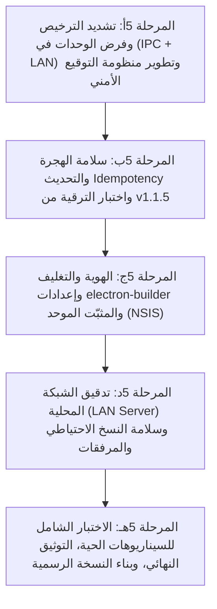

# خطة تنفيذ المرحلة 5 (تفصيلية): الترقية والتغليف والأمان واختبارات الإطلاق متعدد القطاعات

مبنية على مراجعة الكود الفعلي بعد اكتمال المراحل 1 و2 و3 (3أ–3و) و4 (4أ–4هـ). تفصّل هذه الخطة متطلبات وثيقة [05-phase-licensing-release.md](05-phase-licensing-release.md) وتقسّم مهام المرحلة 5 إلى **5 مراحل فرعية متسلسلة ومحكمة (5أ ← 5هـ)**، مع تحديد التعديلات البرمجية، قنوات الـ IPC، مصفوفة الصلاحيات وفرض الوحدات، اختبارات الترقية Idempotent من الإصدار v1.1.5، إعدادات المثبت الموحد (`electron-builder.yml` و`installer.nsh`)، أمان الشبكة المحلية (LAN)، وسيناريوهات الفحص الشامل ودليل المستخدم.

---

## 0. اكتشافات من الكود الفعلي تُوجّه التصميم والتنفيذ

| # | الاكتشاف في الكود الحالي | الأثر والقرار التصميمي والتنفيذي للمرحلة 5 |
|---|--------------------------|--------------------------------------------|
| 1 | **فصل الصلاحيات مقابل تفعيل الوحدات:** نظام الصلاحيات في [channelPolicy.ts](../src/main/channelPolicy.ts) يتحقق من دور المستخدم (`role`) فقط، بينما التحقق من الوحدات النشطة (`modules`) مطبق في الواجهة فقط ([App.vue](../src/renderer/src/App.vue#L44-L144) و[router/index.ts](../src/renderer/src/router/index.ts#L163-L167)). | لضمان الأمان والنزاهة، يجب فرض تفعيل الوحدات في **الخلفية (Main Process & IPC & LAN)** عبر `channelPolicy.ts`. عند تشغيل البرنامج في قطاع الأجهزة المنزلية (`appliances`)، يجب حظر قنوات المبيعات (`sales:*`)، المشتريات (`purchases:*`)، والفحوصات السمعية (`hearingTests:*`, `followups:*`, `earmolds:*`, `implants:*`) فوراً حتى لو تم إرسال الطلب عبر IPC أو شبكة LAN، مع استثناء السوبر أدمن إذا لزم الأمر، أو رفض الطلب بكود خطأ صريح `MODULE_NOT_ALLOWED`. |
| 2 | **تفاعل الـ Foreign Keys مع الهجرة:** دالة `createDatabaseConnection` في [db.ts](../src/main/db.ts#L184) تفعّل `PRAGMA foreign_keys = ON;`. في [runMigrations()](../src/main/db.ts#L240-L400)، يتم إسقاط وإعادة إنشاء جداول `users`, `inventory_movements`, `ticket_parts` عبر `DROP TABLE`. | في قواعد البيانات القديمة الممتلئة، إسقاط جدول مرتبط بعلاقات خارجية أثناء تفعيل `foreign_keys = ON` قد يسبب أخطاء `FOREIGN KEY constraint failed`. يجب تعديل دالة الهجرة لتعطيل `PRAGMA foreign_keys = OFF;` مؤقتاً أثناء إعادة بناء الجداول ثم إعادة تفعيلها بعد نجاح الترقية، لضمان أن تكون الهجرة **Idempotent وآمنة 100%**. |
| 3 | **الترقية التلقائية للنشاط لقواعد v1.1.5 القديمة:** دالة `getBusinessState()` في [db.ts](../src/main/db.ts#L3673-L3700) تفحص إذا كان `business_type` غير مسجل، وتتحقق عبر `isBusinessDataEmpty()` وعدد المستخدمين. إذا وجدت بيانات قديمة، تعين النشاط تلقائياً إلى `'appliances'` وتولد التوقيع وتنشئ النسخة دون قفل النظام (`locked: false`, `needsSetup: false`). | هذا التصميم ممتاز ويضمن استمرارية العمل لعملاء الإصدار v1.1.5 الحاليين دون أي انقطاع أو مطالبة بإعادة التهيئة. سنقوم في المرحلة 5ب بإنشاء سكريبت فحص هجرة آلي يختبر هذا السيناريو عملياً على نسخة بيانات حقيقية. |
| 4 | **حفظ البيانات في مسار المستخدم لا مسار التثبيت:** قاعدة البيانات والمرفقات تُحفظ في `app.getPath('userData')` (أي `AppData\Roaming\sallehli`). | مثبت NSIS في [electron-builder.yml](../electron-builder.yml) يثبت ملفات التطبيق التنفيذية في `%LOCALAPPDATA%\Programs\sallehli` ولا يمس مجلد `%APPDATA%\Roaming`. التحديث أو إعادة التثبيت لا يحذف قاعدة البيانات أو المرفقات إطلاقاً. |
| 5 | **مرفقات المرضى والنسخ الاحتياطي عبر LAN:** في [lanServer.ts](../src/main/lanServer.ts#L209-L247)، نقطة التحميل `/api/backup/download` تنسخ ملف SQLite عبر `createBackupToFile` الذي ينشئ أيضاً مجلد المرفقات `${tempPath}.attachments` على القرص، ولكن الاستجابة عبر المتصفح ترسل ملف الـ `.sqlite` فقط وتترك المجلد المؤقت يتيماً. | يجب في 5د تنظيف المجلد المؤقت للمرفقات، وتوفير خيار تصدير واستعادة المرفقات مع قاعدة البيانات أو ضغطها في أرشيف موحد عبر المتصفح لمنع فقدان المرفقات الطبية عند أخذ النسخ عبر LAN. |
| 6 | **توقيع النشاط والاشتراك (HMAC vs Asymmetric):** التوقيع الحالي في [db.ts](../src/main/db.ts#L85-L130) يعتمد على `crypto.createHmac('sha256', secret)`. | لحماية التراخيص المستقبلية الصادرة من شركة «الجوكر تك»، نُعزز النظام بحيث يدعم التوقيع اللامتماثل (Asymmetric Key - Public/Private Key) لرخص التفعيل الخارجية، مع الاحتفاظ بـ HMAC المحلي المحمي ببصمة الجهاز (Machine GUID / App Secret) لحماية جداول SQLite المحلية من التعديل الخارجي. |
| 7 | **مزامنة الإصدار وهوية البرنامج المزدوجة:** سكريبت [build/sync-installer-version.ps1](../build/sync-installer-version.ps1) يحدّث رقم الإصدار في `index.html` وصور الـ BMP للمثبت. ملف [build/installer.nsh](../build/installer.nsh) يحتوي على نصوص مخصصة للأجهزة الكهربائية فقط. | يجب تحديث `package.json` إلى الإصدار الجديد (`1.2.0`)، وتحديث نصوص الترحيب والتثبيت في `installer.nsh` و`electron-builder.yml` لتعكس النظام المزدوج الشامل (صيانة الأجهزة + مراكز السماعات الطبية). |

---

## 1. خارطة المراحل الفرعية وترتيب التنفيذ

تُنفَّذ المراحل الفرعية بالترتيب، بحيث تُبنى كل مرحلة على السابقة وتختبر معايير قبولها بدقة:



---

## 2. المرحلة الفرعية 5أ: تشديد الترخيص وفرض الوحدات في جميع الطبقات (UI + IPC + LAN)

### 2.1 الهدف
سد أي ثغرة تسمح بتنفيذ عمليات لوحدات غير مرخصة أو غير مفعلة للنشاط النشط، ومنع استدعاء قنوات الـ IPC أو خادم الشبكة المحلية (LAN RPC) الخاصة بالمبيعات أو السمعيات عند تشغيل البرنامج بقطاع الأجهزة المنزلية، ودعم إمكانية ترخيص وحدات إضافية (`licensed_modules`) بمرونة.

### 2.2 التعديلات البرمجية

#### 1. جدول وربط الوحدات بالقنوات في `src/main/channelPolicy.ts`:
- تعريف خريطة متطلبات الوحدات لكل قناة (`CHANNEL_REQUIRED_MODULE`):
  ```ts
  export const CHANNEL_REQUIRED_MODULE: Record<string, string> = {
    // Sales Module
    'sales:list': 'sales',
    'sales:save': 'sales',
    'sales:collectInstallment': 'sales',
    'sales:delete': 'sales',
    'returns:sales:create': 'sales',
    'exchanges:list': 'sales',
    'exchanges:process': 'sales',

    // Purchases Module
    'purchases:list': 'purchases',
    'purchases:save': 'purchases',
    'purchases:delete': 'purchases',
    'returns:purchases:create': 'purchases',

    // Products & Serials Module
    'products:list': 'products',
    'products:getByBarcode': 'products',
    'products:save': 'products',
    'products:delete': 'products',
    'products:serials:list': 'products',
    'products:serials:add': 'products',
    'products:serials:updateStatus': 'products',
    'products:serials:delete': 'products',
    'products:adjustStock': 'products',

    // Suppliers Module
    'suppliers:list': 'suppliers',
    'suppliers:save': 'suppliers',
    'suppliers:delete': 'suppliers',
    'suppliers:statement': 'suppliers',
    'suppliers:pay': 'suppliers',

    // Audiology & Medical Patients Module
    'hearingTests:list': 'followups',
    'hearingTests:save': 'followups',
    'hearingTests:delete': 'followups',
    'hearingTests:latestSummary': 'followups',
    'followups:list': 'followups',
    'followups:save': 'followups',
    'followups:complete': 'followups',
    'followups:delete': 'followups',
    'earmolds:list': 'followups',
    'earmolds:save': 'followups',
    'earmolds:updateStatus': 'followups',
    'earmolds:remake': 'followups',
    'earmolds:delete': 'followups',
    'implants:list': 'followups',
    'implants:save': 'followups',
    'implants:delete': 'followups',
    'implants:sessions:save': 'followups',
    'implants:sessions:delete': 'followups',
    'attachments:list': 'followups',
    'attachments:upload': 'followups',
    'attachments:open': 'followups',
    'attachments:delete': 'followups'
  }
  ```

#### 2. تعديل دالة فحص الوصول `checkChannelAccess`:
- تمرير قائمة الوحدات الفعالة للنشاط والترخيص الحالي (`activeModules: string[]`):
  ```ts
  export function checkChannelAccess(
    channel: string,
    session: SessionInfo | null,
    activeModules: string[]
  ): { allowed: boolean; reason?: string }
  ```
- إذا كانت القناة ترتبط بوحدة معينة غير موجودة في `activeModules` (ولم يكن المستخدم `super_admin` في شاشة إعدادات النظام)، يُرفض الطلب فوراً:
  ```ts
  const requiredModule = CHANNEL_REQUIRED_MODULE[channel]
  if (requiredModule && !activeModules.includes(requiredModule)) {
    return {
      allowed: false,
      reason: `MODULE_NOT_ALLOWED: الوحدة (${requiredModule}) غير مفعلة في نشاط البرنامج الحالي.`
    }
  }
  ```

#### 3. دعم الوحدات المرخصة إضافياً (`licensed_modules`) في `src/main/db.ts`:
- إتاحة حقل في جدول `settings`: `licensed_modules` مع توقيعه `licensed_modules_sig`.
- دالة `getEffectiveModules()`:
  - تجمع بين الوحدات الافتراضية للنشاط من `getBusinessProfile(type).modules`.
  - مع أي وحدات إضافية مرخصة تم تفعيلها وتوقيعها من السوبر أدمن (مثل تفعيل وحدة `sales` لمركز صيانة أجهزة كهربائية يرغب في بيع أجهزة جديدة ومستعملة بجانب الصيانة).

#### 4. تطوير وتأمين التوقيع الرقمي (Cryptographic Security Review):
- دعم بصمة الجهاز المحلية: ربط توقيع النشاط بـ Machine Salt مشتق من معرف الجهاز لمنع نسخ قاعدة البيانات ونقلها إلى جهاز آخر مع تغيير النشاط دون إذن.
- فصل حماية التلاعب المحلي (Local Tamper Proofing عبر HMAC-SHA256) عن التراخيص الصادرة من الشركة (Vendor Licensing عبر مفتاح عام Asymmetric Ed25519/RSA).
- عند فشل التوقيع، يستمر النظام في تطبيق حالة القفل `BUSINESS_LOCKED` لمنع الوصول للبيانات الحساسة حتى استعادة الترخيص.

### 2.3 معيار قبول المرحلة الفرعية 5أ
- [x] عند ضبط النشاط على `appliances`، إرسال أي استدعاء لقنوات `sales:*` أو `hearingTests:*` عبر IPC أو LAN يُرفض مباشرة برسالة `MODULE_NOT_ALLOWED`.
- [x] في قطاع `hearing_aids`، جميع القنوات تعمل بشكل طبيعي ومصرح به للأدوار المعنية.
- [x] دعم تفعيل وحدة إضافية موثقة بتوقيع صحيح لقطاع الصيانة (مثل وحدة المبيعات).
- [x] التلاعب اليدوي بقيمة النشاط في جدول `settings` يؤدي فوراً إلى تفعيل وضع القفل `BUSINESS_LOCKED`.

---

## 3. المرحلة الفرعية 5ب: سلامة الهجرة والتحديث والتوافقية مع v1.1.5 (Idempotency & Safe Upgrade)

### 3.1 الهدف
التأكد من أن الترقية من الإصدار v1.1.5 (أو أي إصدار وسيط) إلى الإصدار الجديد تعمل بسلاسة تامة، دون فقدان أي حقل أو سجل، ودون أي تعارض مع القيود الخارجية (Foreign Keys)، مع وجود نسخة احتياطية تلقائية إلزامية قبل بدء الترقية.

### 3.2 التعديلات البرمجية

#### 1. تحصين دالة `runMigrations()` في `src/main/db.ts`:
- **تعطيل الـ Foreign Keys أثناء إعادة هيكلة الجداول:**
  ```ts
  function runMigrations(): void {
    const prevFk = (db.prepare('PRAGMA foreign_keys;').get() as { foreign_keys: number }).foreign_keys
    db.exec('PRAGMA foreign_keys = OFF;')
    try {
      // 1. Upgrade users table if needed
      // ...
      // 2. Upgrade inventory_movements table if needed
      // ...
      // 3. Upgrade ticket_parts table if needed
      // ...
      // 4. Ensure all new columns (extra_data, images, medical fields, etc.)
    } finally {
      if (prevFk) {
        db.exec('PRAGMA foreign_keys = ON;')
      }
    }
  }
  ```
- **مراجعة فحص Idempotency:**
  - كل استدعاء `ensureColumn` يفحص وجود العمود عبر `PRAGMA table_info` قبل محاولة تنفيذه.
  - جميع أوامر الجداول الجديدة تستخدم `CREATE TABLE IF NOT EXISTS`.
  - كل عمليات الترقية الفرعية يمكن إعادة تشغيلها 100 مرة متتالية على نفس قاعدة البيانات دون أي خطأ أو تكرار بيانات.

#### 2. النسخ الاحتياطي التلقائي قبل التحديث في `src/main/updater.ts` و`db.ts`:
- التأكد من أن `createPreUpdateBackup()` يُستدعى دائماً قبل إغلاق قاعدة البيانات وتشغيل المثبت الجديد.
- التأكد من أن مجلد المرفقات الطبية `patient_attachments` يتم نسخه جنباً إلى جنب مع ملف قاعدة البيانات SQLite باسم `<backupPath>.attachments`.
- تسجيل مسار النسخة الاحتياطية في ملف سجلات وتنبيه المستخدم بمكان حفظها قبل إعادة تشغيل البرنامج.

#### 3. إنشاء سكريبت فحص الترقية الآلي (`scripts/verify-v115-migration.ts`):
- سكريبت برمجي مستقل يقوم بـ:
  1. إنشاء قاعدة بيانات SQLite تجريبية تطابق حرفياً هيكل الإصدار القديم v1.1.5 (جداول `users` بالقيود القديمة، `customers`, `customer_appliances`, `technicians`, `spare_parts`, `inventory_movements`, `maintenance_tickets`, `ticket_parts`, `treasury_transactions`، دون أي وجود لحقول القطاعات أو الحقول المخصصة).
  2. حقن بيانات حقيقية (عملاء، تذاكر صيانة، حركات مخزن، مبالغ بالخزينة).
  3. تشغيل `initDatabase()` للمرحلة الحالية.
  4. التحقق البرمجي التلقائي:
     - بقاء جميع سجلات العملاء وتذاكر الصيانة وقطع الغيار والخزينة القديمة سليمة بنسبة 100%.
     - إضافة جميع الحقول الجديدة والقيم الافتراضية.
     - ضبط `business_type` تلقائياً على `'appliances'` بتوقيع رقمي صالح.
     - أن تكون النتيجة `needsSetup === false` و`locked === false`.
     - قدرة المستخدمين القدامى على تسجيل الدخول بكلمات مرورهم القديمة بنجاح بعد الترقية.

### 3.3 معيار قبول المرحلة الفرعية 5ب
- [x] سكريبت `verify-v115-migration.ts` ينجح كاملاً بنسبة 100% دون أي أخطاء.
- [x] تشغيل `runMigrations()` أكثر من مرة لا يسبب أي خطأ ولا يُكرر البيانات.
- [x] إنشاء نسخة احتياطية كاملة (`Sallehli-PreUpdate-*.sqlite`) مع مجلد المرفقات قبل كل تحديث.
- [x] قواعد البيانات القديمة تفتح في قطاع `appliances` مباشرة دون الحاجة لشاشة الإعداد الأولي.

---

## 4. المرحلة الفرعية 5ج: الهوية والتغليف وإعدادات المثبّت الموحد (Branding & Packaging)

### 4.1 الهدف
بناء مثبّت Windows احترافي موحد (`.exe`) يجمع هويتي النظام (صلحلي / أريتون) مع اسم تنفيذي ثابت، وأيقونات وشاشات ترحيب معبرة عن تعدد القطاعات، وتحديث أرقام الإصدار في جميع ملفات المشروع.

### 4.2 التعديلات البرمجية

#### 1. تحديث `package.json`:
- رفع رقم الإصدار من `1.1.5` إلى `1.2.0`:
  ```json
  "version": "1.2.0",
  "description": "صلحلي / أريتون - النظام الشامل لإدارة مراكز صيانة الأجهزة ومراكز السماعات الطبية"
  ```

#### 2. تحديث إعدادات التغليف في `electron-builder.yml`:
- ضبط اسم المنتج المعروض في لوحة التحكم وقائمة البرامج:
  ```yaml
  productName: صلحلي / أريتون - نظام الإدارة المتكامل
  executableName: Sallehli
  nsis:
    artifactName: ${name}-v${version}-Setup-x64.${ext}
    shortcutName: صلحلي - أريتون
    uninstallDisplayName: صلحلي / أريتون v${version} - نظام الإدارة المتكامل
  ```
- الحفاظ على `executableName: Sallehli` يضمن أن التحديث يستبدل الملف التنفيذي القديم في نفس المجلد دون إنشاء نسختين متوازيتين على جهاز العميل.

#### 3. تحديث نصوص مثبت NSIS في `build/installer.nsh`:
- تعديل رسائل الترحيب والتحديث لتوضح شمولية النظام لكلا النشاطين:
  ```nsis
  !define MUI_WELCOMEPAGE_TITLE "مرحباً بك في معالج تثبيت برنامج صلحلي / أريتون v${VERSION}"
  !define MUI_WELCOMEPAGE_TEXT "سيقوم هذا المعالج بتثبيت الإصدار v${VERSION} المطور بواسطة (الجوكر تك) على جهازك.$\r$\n$\r$\nالنظام المتكامل لإدارة الأنشطة والخدمات المتخصصة:$\r$\n  • صيانة الأجهزة المنزلية والكهربائية (صلحلي)$\r$\n  • مراكز وتوكيلات السماعات الطبية وفحوصات السمع (أريتون)$\r$\n  • إدارة المبيعات والمشتريات والمخازن وضمان الأجهزة$\r$\n  • إدارة الخزينة والحسابات والنسخ الاحتياطي التلقائي$\r$\n$\r$\nاضغط على (التالي) للمتابعة في عملية التثبيت."
  ```
- تحديث رسالة الترقية التلقائية لتؤكد للمستخدم الحفاظ الكامل على قاعدة بياناته ونشاطه الحالي.

#### 4. مزامنة الإصدارات والصور النقطية:
- تشغيل واختبار سكريبت `npm run sync-version`:
  - يتأكد من مزامنة `v1.2.0` داخل [src/renderer/index.html](../src/renderer/index.html).
  - يرسم شارة الإصدار الجديد باللون الذهبي داخل شريط التثبيت `installerSidebar.bmp` وشريط إلغاء التثبيت `uninstallerSidebar.bmp`.

#### 5. ديناميكية عنوان النافذة والأيقونة حسب النشاط:
- عند بدء التشغيل أو تبديل النشاط أو استعادة النسخة الاحتياطية في `src/main/index.ts`:
  - شريط العنوان: `${profile.appName} v${app.getVersion()} - ${profile.windowTitle}`.
  - عند اختيار قطاع الأجهزة: "صلحلي v1.2.0 - نظام إدارة مراكز صيانة الأجهزة المنزلية والكهربائية".
  - عند اختيار قطاع السماعات: "أريتون v1.2.0 - نظام إدارة مراكز وتوكيلات السماعات الطبية".
  - تحديث أيقونة النافذة وشريط المهام ديناميكياً لتطابق القطاع المختار.

### 4.3 معيار قبول المرحلة الفرعية 5ج
- [x] سكريبت `npm run sync-version` يعمل بنجاح ويحدث الإصدار في ملفات المشروع والصور.
- [x] بناء التطبيق التجريبي `npm run build` ينجح بنسبة 100% دون أي تحذيرات أو أخطاء TypeScript.
- [x] عنوان النافذة وأيقونتها يتبدلان تلقائياً بين "صلحلي" و"أريتون" حسب النشاط الفعال.
- [x] معالج التثبيت والترقية يعرض نصوصاً واضحة تعبر عن النظام المزدوج الشامل.

---

## 5. المرحلة الفرعية 5د: تدقيق الشبكة المحلية والأمان عبر LAN (LAN Parity & Security)

### 5.1 الهدف
التأكد من أن جميع وظائف المراحل السابقة (المبيعات، المشتريات، الموردين، فحوصات السمع، قوالب الأذن، القوقعة الإلكترونية، المرفقات، والنسخ الاحتياطي) تعمل بكفاءة وأمان كامل عبر الشبكة المحلية والمتصفح مع احترام الصلاحيات الطبية والمالية.

### 5.2 التعديلات البرمجية

#### 1. مراجعة وتدقيق جسر المتصفح `src/renderer/src/utils/webApiBridge.ts`:
- التحقق من تطابق جميع دوال `webApiBridge` مع الواجهة `IElectronAPI` وتمرير معرّف الجلسة `_token` بصورة آمنة.
- التأكد من قدرة عملاء المتصفح على رفع المرفقات الطبية عبر DataURL وتحويلها إلى ملفات محلية على الخادم الرئيسي بنجاح.

#### 2. تأمين نقطة تحميل النسخ الاحتياطية `/api/backup/download` في `src/main/lanServer.ts`:
- **حماية تذكرة الأمان (Single-use Ticket):** تظل سارية مع التحقق من صلاحية المدير (`manager` / `super_admin`).
- **إدارة المرفقات الطبية في النسخ الاحتياطي عبر LAN:**
  - عند طلب تحميل نسخة احتياطية من المتصفح، تنظيف المجلد المؤقت `${tempPath}.attachments` فور اكتمال الإرسال لمنع تراكم الملفات المؤقتة على القرص.
  - توفير دالة تصدير/استيراد متوافقة تدعم تنزيل قاعدة البيانات ومرفقاتها معاً في ملف أرشيف واحد عند الحاجة.

#### 3. مراجعة الصلاحيات والخصوصية الطبية عبر LAN:
- فحص استدعاءات `/api/rpc`: التأكد من أن جلسة المستخدم الواردة في الـ payload تخضع لنفس معايير `checkChannelAccess`:
  - الكاشير وأمين المخزن لا يستطيعان فتح السجلات الطبية للمرضى أو استعراض الفحوصات والأوديوجرام وملفات البرمجة عبر المتصفح.
  - أي محاولة لاستدعاء قنوات `medical` من حساب غير مصرح به تُرفض بخطأ 403 / JSON error.

### 5.3 معيار قبول المرحلة الفرعية 5د
- [x] فتح واجهة البرنامج عبر المتصفح من جهاز آخر على الشبكة المحلية وتسجيل الدخول بنجاح.
- [x] إنشاء فاتورة مبيعات، تسجيل فحص سمع أوديوجرام، ورفع مرفق طبي عبر المتصفح والتحقق من حفظها الفعلي في قاعدة البيانات وملفات الخادم.
- [x] تطبيق القيود الأمنية والطبية عبر المتصفح ومنع الأدوار غير المصرح لها من الوصول لبيانات المرضى.
- [x] تحميل النسخة الاحتياطية عبر المتصفح بتذكرة أمان بنجاح وتنظيف الملفات المؤقتة تلقائياً.

---

## 6. المرحلة الفرعية 5هـ: الاختبار الشامل، التوثيق، والبناء النهائي (E2E Testing, Docs & Release)

### 6.1 مصفوفة سيناريوهات الفحص الشامل (End-to-End Scenarios)

| السيناريو | الخطوات العملية | النتيجة المتوقعة والمعيار |
|-----------|-----------------|---------------------------|
| **س1: التثبيت النظيف واختيار قطاع الأجهزة (صلحلي)** | 1. تشغيل التطبيق بقاعدة بيانات جديدة فارغة.<br>2. ظهور معالج الإعداد الأولي للسوبر أدمن.<br>3. اختيار «صيانة الأجهزة المنزلية والكهربائية». | - تهيئة النشاط على `appliances` وتوليد التوقيع.<br>- فتح لوحة التحكم ووحدات الصيانة والمخزن فقط.<br>- اختفاء المبيعات والمشتريات والفحوصات السمعية تماماً.<br>- ظهور المصطلحات وقوائم الأجهزة والماركات الخاصة بالأجهزة الكهربائية. |
| **س2: التثبيت النظيف واختيار قطاع السماعات (أريتون)** | 1. تشغيل التطبيق بقاعدة بيانات جديدة فارغة.<br>2. اختيار «مركز السماعات الطبية والأوديولوجي». | - تهيئة النشاط على `hearing_aids`.<br>- ظهور وحدات المبيعات، المشتريات، الموردين، والمتابعات السمعية.<br>- تحول نافذة العميل إلى ملف مريض متكامل ذي 6 تبويبات.<br>- تفعيل رسم الأوديوجرام وقوالب الأذن والقوقعة الإلكترونية. |
| **س3: ترقية قاعدة بيانات الإصدار السابق v1.1.5** | 1. وضع قاعدة بيانات فعلية لإصدار v1.1.5 في مجلد المستخدم.<br>2. تشغيل التطبيق الجديد. | - تنفيذ `runMigrations()` دون أخطاء.<br>- التعرف التلقائي على النشاط وتعيينه `appliances` دون مطالبة بإعداد أولي.<br>- الحفاظ الكامل على العملاء والفنيين وطلبات الصيانة والمخزن والخزينة القديمة. |
| **س4: تبديل النشاط (Empty vs Non-Empty)** | 1. تجربة تبديل النشاط عندما تكون البيانات فارغة.<br>2. تجربة التبديل بعد إدخال تذاكر وفواتير: إدخال كلمة مرور خاطئة ثم صحيحة. | - التبديل التلقائي إذا كانت البيانات فارغة.<br>- منع التبديل عند وجود بيانات إلا بكلمة مرور السوبر أدمن.<br>- أخذ نسخة احتياطية إجبارية تلقائية `Sallehli-PreSwitch-*.sqlite` قبل التبديل.<br>- تحديث عنوان النافذة والمصطلحات فوراً. |
| **س5: اكتشاف التلاعب وقفل النظام الأمني** | 1. إغلاق البرنامج وفتح ملف SQLite بأداة خارجية.<br>2. تعديل قيمة `business_type` يدوياً دون توقيع صالح.<br>3. إعادة تشغيل البرنامج. | - اكتشاف عدم تطابق التوقيع في `getBusinessState()`.<br>- تفعيل حالة `BUSINESS_LOCKED`.<br>- حظر جميع العمليات وإظهار تنبيه القفل للسوبر أدمن في شاشة إعدادات البرنامج للاستعادة. |
| **س6: حماية البيانات الطبية والصلاحيات** | 1. الدخول بحساب أمين مخزن (`storekeeper`) أو كاشير (`cashier`).<br>2. محاولة فتح السجل الطبي أو الفحوصات للمريض في قطاع السماعات. | - حجب التبويبات الطبية وفحوصات الأوديوجرام وبرمجة القوقعة والمرفقات عن الحساب.<br>- قصر رؤيته على الاسم والهاتف والعنوان والفواتير التجارية فقط. |
| **س7: النسخ الاحتياطي الشامل واستعادة المرفقات** | 1. رفع مرفقات طبية لمريض وإصدار فواتير وفحوصات.<br>2. أخذ نسخة احتياطية يدوية.<br>3. حذف أحد المرفقات أو تعديل بيانات.<br>4. استعادة النسخة الاحتياطية. | - استعادة ملف SQLite كاملاً.<br>- استعادة مجلد المرفقات `patient_attachments` من المجلد المرافق.<br>- استرجاع المرفق الطبي المحذوف وإمكانية فتحه ومعاينته بنجاح. |
| **س8: الطباعة والتقارير في القطاعين** | 1. طباعة إيصال صيانة A4 وإيصال حراري 80mm في صلحلي.<br>2. طباعة تقرير أوديوجرام A4 ملون وإيصال قالب أذن في أريتون. | - تطبيق المصطلحات المناسبة لكل قطاع في المطبوعات.<br>- وضوح رسم منحنى السمع للأذنين ودرجات الفقد في تقرير الأوديوجرام. |

### 6.2 إعداد أدلة المستخدم التوثيقية
- إنشاء دليلين شاملين ومنظمين داخل مجلد `docs/`:
  1. **`docs/USER_GUIDE_APPLIANCES.md`**: دليل استخدام برنامج «صلحلي» لإدارة مراكز صيانة الأجهزة المنزلية والكهربائية (تسجيل البلاغات، إدارة الفنيين، حساب النسب والعمولات، مخزن قطع الغيار، الخزينة، وإعدادات المركز والطباعة).
  2. **`docs/USER_GUIDE_HEARING_AIDS.md`**: دليل استخدام برنامج «أريتون» لإدارة مراكز السماعات الطبية (ملف المريض، إجراء فحوصات السمع ورسم الأوديوجرام، مبيعات السماعات والأرقام التسلسلية، طلبات قوالب الأذن، زراعة وبرمجة القوقعة، والمتابعات الدورية).

### 6.3 بناء النسخة الرسمية Windows Installer (`build:win`)
- تنفيذ أوامر البناء بالترتيب:
  ```powershell
  npm run sync-version
  npm run build
  npm run build:win
  ```
- التأكد من توليد ملف المثبت النهائي:
  `dist/sallehli-v1.2.0-Setup-x64.exe`
- فحص حجم المثبت والتأكد من ضغط LZMA2 الأقصى وعمله بكفاءة.

### 6.4 معيار قبول المرحلة الفرعية 5هـ
- [x] اجتياز جميع سيناريوهات الفحص الثمانية بنجاح تام دون أي خلل.
- [x] اكتمال دليلي المستخدم للقطاعين بصياغة واضحة وإرشادات مصورة وشاملة.
- [x] نجاح أمر `npm run build:win` وإنتاج المثبت التنفيذي `dist/sallehli-v1.2.0-Setup-x64.exe`.
- [x] تجربة تثبيت المثبت على جهاز Windows نظيف وتشغيله بنجاح واستقرار تام.

---

## 7. مصفوفة الصلاحيات وقنوات الـ IPC ومطابقتها للوحدات

| نطاق القنوات | الصلاحية الدنيا (`role`) | الوحدة المطلوبة (`module`) | السلوك عند إلغاء تفعيل الوحدة |
|--------------|--------------------------|----------------------------|-------------------------------|
| `auth:*`, `settings:get`, `app:version`, `business:getPublic` | `public` | عام | متاح دائماً |
| `dashboard:stats` | `authenticated` | `dashboard` | متاح دائماً لجميع القطاعات |
| `customers:list`, `save`, `findByPhone` | `authenticated` | `customers` | متاح للقطاعين (مع إخفاء الحقول الطبية لغير قطاع السماعات) |
| `tickets:*` | `authenticated` / `manager` | `tickets` | متاح للقطاعين مع مطابقة المصطلحات |
| `parts:*`, `inventory:*` | `authenticated` / `inventory` | `inventory` | متاح للقطاعين |
| `treasury:*`, `reports:*` | `financial` | `treasury` / `reports` | متاح للقطاعين |
| `sales:*`, `exchanges:*` | `authenticated` / `manager` | `sales` | **محظور تماماً** في قطاع `appliances` إلا بترخيص إضافي |
| `purchases:*` | `authenticated` / `manager` | `purchases` | **محظور تماماً** في قطاع `appliances` إلا بترخيص إضافي |
| `products:*`, `suppliers:*` | `authenticated` / `manager` | `products` / `suppliers` | **محظور تماماً** في قطاع `appliances` إلا بترخيص إضافي |
| `patients:profile` | `medical` | `customers` | متاح في قطاع السماعات للأدوار الطبية فقط |
| `hearingTests:*`, `followups:*`, `earmolds:*`, `implants:*`, `attachments:*` | `medical` / `manager` | `followups` | **محظور تماماً** في قطاع `appliances` |
| `business:*`, `system:*`, `backup:restore`, `update:*` | `super_admin` | إدارة النظام | متاح للسوبر أدمن فقط للتحكم والتأمين |

---

## 8. خطة إدارة المخاطر والرجوع للوراء (Risk Mitigation & Rollback Plan)

| المخاطرة المحتملة | الإجراء الوقائي المعتمد | خطة الطوارئ والرجوع للوراء (Rollback) |
|-------------------|-------------------------|---------------------------------------|
| تعطل قاعدة البيانات أثناء الترقية من v1.1.5 | إنشاء نسخة احتياطية مسبقة تلقائياً قبل تشغيل أوامر الهجرة `Sallehli-PreUpdate-*.sqlite`. | في حال حدوث أي خطأ، يتم استرجاع النسخة الاحتياطية تلقائياً وإيقاف عملية الترقية وإظهار تقرير الخطأ للمستخدم. |
| فشل إسقاط أو تعديل جدول بسبب Foreign Keys | تعطيل `PRAGMA foreign_keys = OFF;` مؤقتاً داخل المعاملة `runTransaction` وإعادة تفعيلها فور الانتهاء. | تظل المعاملة الذرية (Atomic Transaction) تحمي البيانات وتلغي أي تغييرات غير مكتملة عبر `ROLLBACK`. |
| فقدان المرفقات الطبية عند استعادة نسخة احتياطية | حفظ المرفقات في مجلد مرافق `<backupPath>.attachments` ونسخه واستعادته آلياً مع ملف قاعدة البيانات. | دمج فحص وجود المجلد المرافق في دوال النسخ والاستعادة والتنبيه بوجوده. |
| تعارض أسماء ملفات التثبيت القديمة والجديدة | الإبقاء على المعرف `appId: com.sallehli.aljoker` واسم الملف التنفيذي `executableName: Sallehli`. | يضمن تحديث التطبيق القديم في نفس مكانه بسلاسة ودون تشتيت العميل بين مثبتين. |

---

## 9. جدول التحقق من معايير القبول النهائية للمرحلة 5

- [x] **الترخيص والوحدات (5أ):** فرض الوحدات في الخلفية، رفض القنوات غير المرخصة، وتأمين التوقيع الرقمي.
- [x] **الهجرة والترقية (5ب):** اختبار الترقية من v1.1.5 بنجاح، سلامة الـ Idempotency، وحفظ النسخ التلقائية.
- [x] **الهوية والتغليف (5ج):** رفع الإصدار إلى v1.2.0، مزامنة شارات المثبت، وديناميكية عنوان النافذة والأيقونات.
- [x] **الشبكة المحلية (5د):** عمل المبيعات والسمعيات بكفاءة عبر LAN، حماية الخصوصية الطبية، وتأمين النسخ الاحتياطي.
- [x] **الاختبار الشامل (5هـ):** اجتياز سيناريوهات الفحص الثمانية بنجاح، بناء المثبت النهائي، واكتمال دليلي المستخدم.
